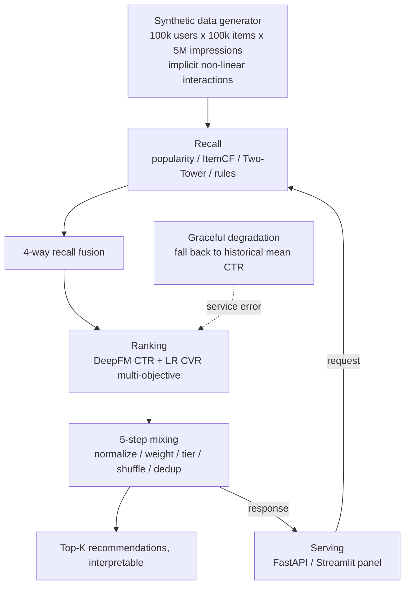

# AeroRec · Travel Recommendation Platform

> 🌐 [简体中文](README.md) | English

**AeroRec** is an engineering-grade **travel recommendation platform** (flights / hotels / shopping / deals / live)
that reproduces an industrial pipeline end-to-end on a **reproducible synthetic dataset**, plus a fully
instrumented **bias-measurement research thread** built on an oracle setting: the latent true CTR is known
analytically and the exposure propensity is closed-form, so bias can be *measured exactly* — not just estimated.

- **Live demo (bilingual EN / 中文, toggle in the sidebar)**: <https://aerorec-tourism.streamlit.app>
- **Project homepage**: <https://elijah-lin-dancer.github.io/AeroRec/>
- **Research thread**: [tech report](docs/bias_report.md) · [paper-reader doc](docs/tech-report.md) ·
  [visual report (HTML)](data/bias/report.html) · [one-pager (EN)](docs/research_highlight.md)

---

## Highlights

- **Industrial pipeline, end to end**: 4-way recall (popularity / ItemCF / Two-Tower / rules) → DeepFM CTR
  ranking + LR CVR → 5-step mixing → graceful degradation → FastAPI / Streamlit serving → interpretable Top-K.
- **Real-data transferability**: the *same* DeepFM implementation reaches **AUC 0.7733** (Criteo, 1 M rows) /
  **0.9183** (UCI Adult) — evidence the implementation learns real signal, *not* that Criteo weights rank
  travel items (different feature schema).
- **Online serving discipline**: pure-**numpy** forward pass, **no `torch` at serve time**; engine peak
  ≈ **129 MB**, single-thread **P50 ≈ 0.7 ms / P99 ≈ 0.95 ms**, QPS ≈ 1378 (micro tier, measured).
- **Reproducibility as a gate**: CI re-runs all experiments on every push and checks the 7 result JSONs
  **byte-for-byte** against the committed artifacts.

## Architecture



## Research: bias diagnosis and the debiasing boundary

Under biased exposure (π ∝ popularity^τ), the ranking-level Spearman correlation against the true CTR
**inverts** (500 items × 5,000 requests, 30-seed mean ± std):

| τ (exposure skew) | 0.0 | 0.5 | 1.0 | 2.0 | 3.0 |
|---|---|---|---|---|---|
| Ranking-level Spearman (L2) | **+0.87** | +0.80 | +0.63 | +0.03 | **−0.51** |
| Min impressions (coldest item) | 30.1 | 15.3 | 5.4 | 0.1 | **0.0** |

Key findings (all statistically validated, numpy-only bootstrap):

- **The main harm is ranking inversion, not inflation** — sign flips between τ ≈ 2 and 3 (p < 0.001).
- **Debiasing has an effective boundary set by propensity range, not bias strength**: below
  **`ESS/N ≈ 0.358`**, IPS/SNIPS gains turn negative (stable across an 8× scale-up). `ESS/N` needs no
  ground truth → deployable warning signal.
- **Mixing re-injection is signed**: duplicated popularity hurts (default `w_base = 0`); independent info helps.
- **Robust to propensity estimation error**: log-estimated π̂ replaces closed-form π with insignificant
  SNIPS change (p = 0.87); the ESS warning stays fail-safe (false alarms only, zero misses).
- **User-side bias must be modeled at user-item granularity**: self-selection drifts the pooled-CTR
  estimand from 0.281 to 0.702 (2.5× apparent inflation); item-marginal debiasing leaves a significant
  residual (+0.06 → +0.22, p < 0.001), while correct user-item-level debiasing keeps error at 0.004–0.037.

Details: [docs/bias_report.md](docs/bias_report.md) (§8 extensions) · [docs/tech-report.md](docs/tech-report.md).

## Quick start

```bash
pip install -r requirements_full.txt   # full deps (torch / sklearn) for local dev & reproduction
python -m src.pipeline_demo            # data + 4-way recall + fusion + sample recommendations
python -m src.eval.evaluate            # LR vs DeepFM AUC + true-CTR comparison + oracle bound
python scripts/run_bias_experiments.py # bias research → 7 result JSONs (drift-gated)
python -m pytest                       # 133 tests
```

> ⚠️ Everything is synthetic; the online demo's numbers are for interaction only. Citable conclusions use
> the offline **full tier** (100 k × 100 k × 5 M). Real-data validation (Criteo / Adult) is a transferability
> check, not a travel-domain result.

## Documentation

| Doc | What it is |
|---|---|
| [README.md](README.md) | 简体中文完整版 |
| [docs/tech-report.md](docs/tech-report.md) | Paper-reader technical doc (config + raw numbers + limitations) |
| [docs/bias_report.md](docs/bias_report.md) | Bias research full narrative (mechanisms, corrected errors) |
| [docs/research_highlight.md](docs/research_highlight.md) | One-page EN research summary |
| [data/bias/report.html](data/bias/report.html) | Self-contained visual report |
| [CHANGELOG.md](CHANGELOG.md) | Version history ([0.1.0] = 2026-10-15) |

## Honest limitations

- Synthetic data: method validity **under controlled conditions**, not online transferability. The oracle
  setting is the enabling assumption and a limitation at once.
- Real multi-user structures and real self-selection datasets (Coat / Open Bandit) remain future work.
- No new algorithm is proposed: all estimators and metrics are standard; the contribution is the
  measurement methodology and the deployable decision rule.

## License

See [LICENSE](LICENSE) and the data-permission notes in [README.md](README.md) (synthetic data MIT /
UCI Adult citation requirement / Criteo terms).
