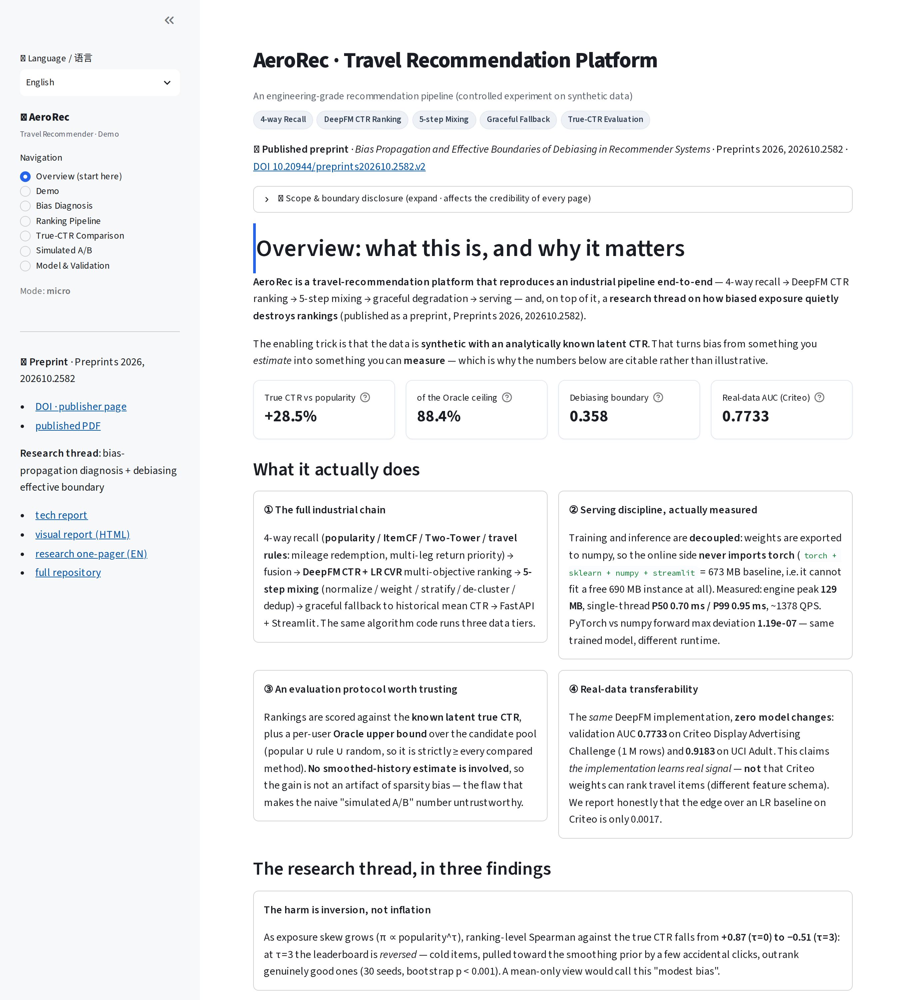
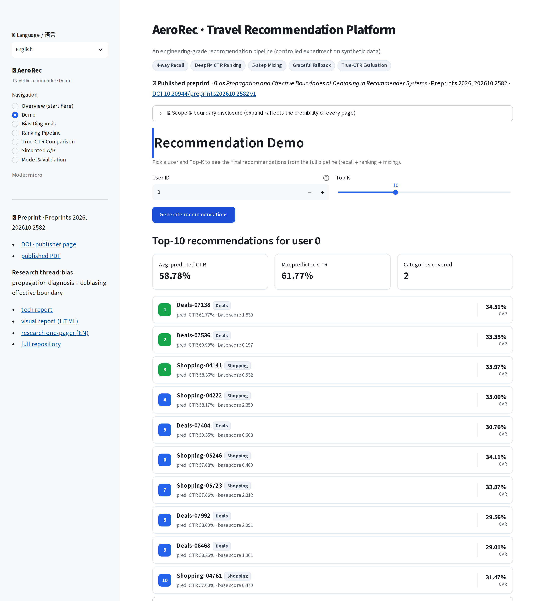
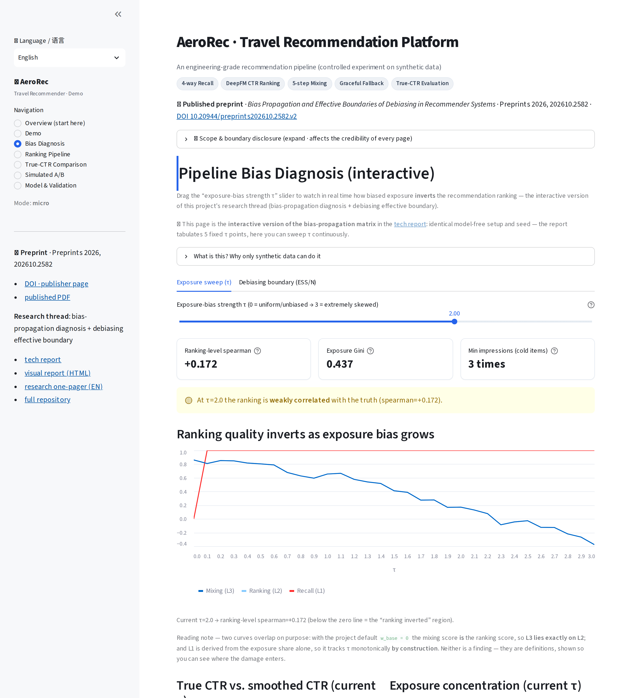
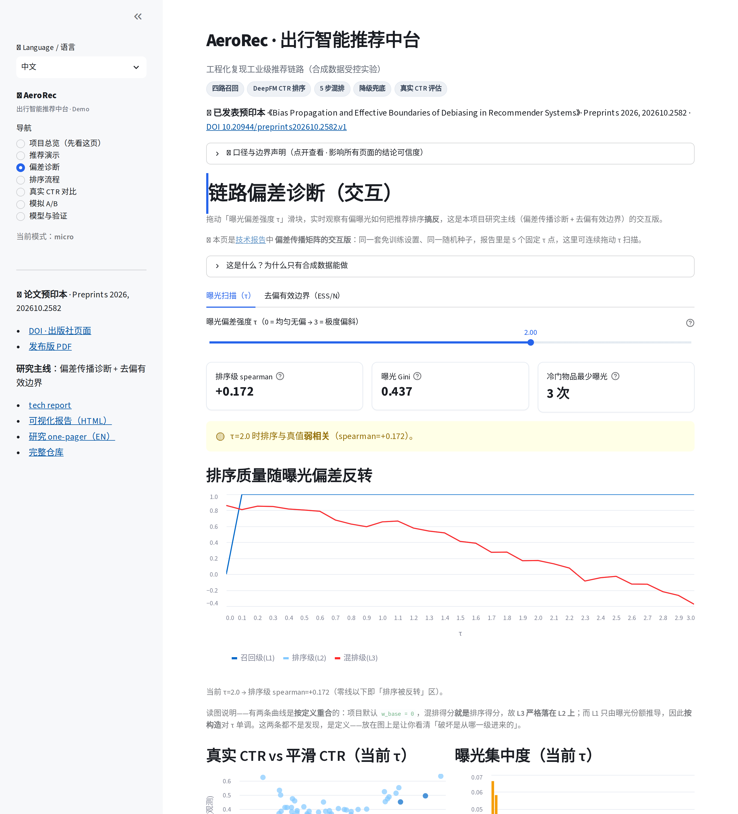
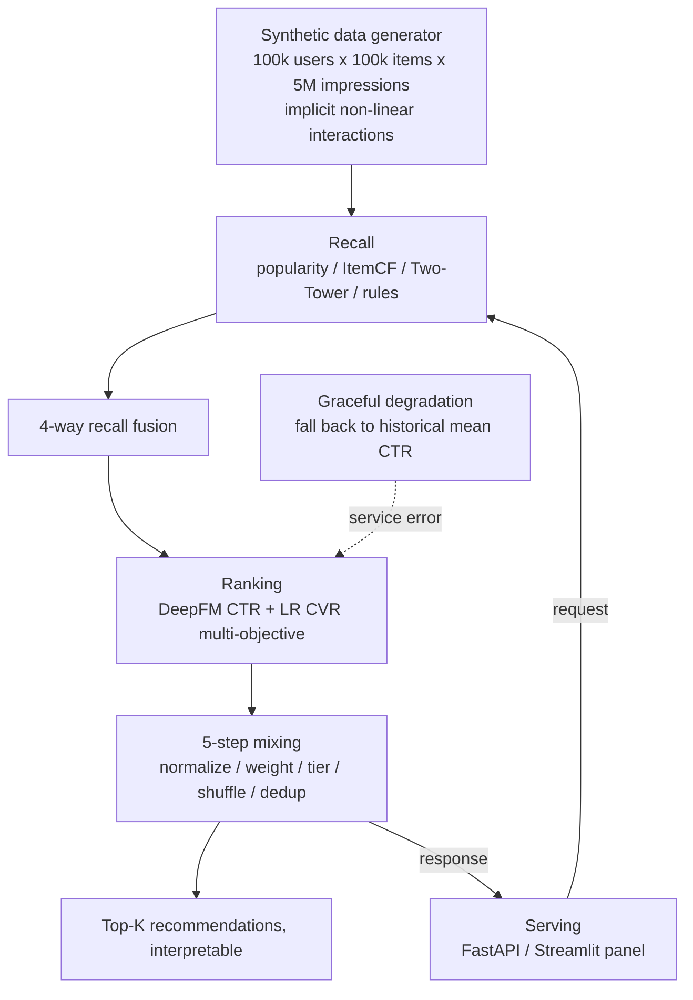

# AeroRec · Travel Recommendation Platform

> 🌐 [简体中文](README.zh.md) | English

[](https://www.python.org/)
[](LICENSE)
[](https://aerorec-tourism.streamlit.app)
[](https://streamlit.io/)
[](https://elijah-lin-dancer.github.io/AeroRec/)
[](https://github.com/Elijah-Lin-Dancer/AeroRec/actions/workflows/repro.yml)
[](https://doi.org/10.20944/preprints202610.2582.v2)
[](https://doi.org/10.5281/zenodo.24003810)

**AeroRec** is an engineering-grade **travel recommendation platform** (flights / hotels / shopping / deals /
live) that reproduces an industrial pipeline end-to-end on a **reproducible synthetic dataset**, plus a fully
instrumented **bias-measurement research thread** built on an oracle setting: the latent true CTR is known
analytically and the exposure propensity is closed-form, so bias can be *measured exactly* — not just estimated.

- **Live demo (bilingual EN / 中文, toggle in the sidebar)**: <https://aerorec-tourism.streamlit.app>
- **Project homepage**: <https://elijah-lin-dancer.github.io/AeroRec/>
- **Research thread**: [tech report](docs/bias_report.md) · [paper-reader doc](docs/tech-report.md) ·
  [visual report (HTML)](data/bias/report.html) · [one-pager (EN)](docs/research_highlight.md)

---

## 📖 Published Preprint (Preprints.org)

> ***Bias Propagation and Effective Boundaries of Debiasing in Recommender Systems: An Oracle-Based Diagnosis Study*** — Yulin Zhao, Preprints.org **2026, 202610.2582** (V2, posted 2026-11-06; V1 posted 2026-10-27).
>
> **DOI**: [10.20944/preprints202610.2582.v2](https://doi.org/10.20944/preprints202610.2582.v2) · [Manuscript page](https://www.preprints.org/manuscript/202610.2582/v2) · [Published PDF](docs/paper/AeroRec-preprints.org-v2.pdf) · [Author-typeset PDF](docs/paper/AeroRec-preprint.pdf)
>
> **What changed in v2**: one value. The small-scale debiasing boundary in §4.2 and the Fig. 3 caption was reported as `ESS/N = 0.3576`, which cannot be reproduced from the released code; re-running the committed pipeline with the same configuration gives `0.3625`. The conclusion — the boundary is stable across pipeline scales — is unchanged. V1 stays online with its own DOI and remains the record of that value; the repository state it corresponds to is tagged `preprint-v1`.

**How to cite the preprint**:

```text
Zhao, Y. Bias Propagation and Effective Boundaries of Debiasing in Recommender
Systems: An Oracle-Based Diagnosis Study. Preprints 2026, 202610.2582.
https://doi.org/10.20944/preprints202610.2582.v2
```

**How to cite the software** — archived on Zenodo as v1.1.0 (the archive of `preprint-v2`):

```text
Zhao, Y. AeroRec: an oracle-based diagnosis platform for bias propagation and
debiasing boundaries in recommender systems. Zenodo (2026), v1.1.0.
https://doi.org/10.5281/zenodo.24003811
```

> The **concept DOI** `10.5281/zenodo.24003810` always resolves to the latest release; the **version DOI** above
> pins this exact archive.

<details>
<summary><strong>BibTeX</strong></summary>

```bibtex
@article{zhao2026aerorec,
  title   = {Bias Propagation and Effective Boundaries of Debiasing in Recommender Systems: An Oracle-Based Diagnosis Study},
  author  = {Zhao, Yulin},
  journal = {Preprints},
  year    = {2026},
  number  = {202610.2582},
  doi     = {10.20944/preprints202610.2582.v2},
  url     = {https://doi.org/10.20944/preprints202610.2582.v2}
}

@software{zhao2026aerorec_zenodo,
  title   = {AeroRec: an oracle-based diagnosis platform for bias propagation and debiasing boundaries in recommender systems},
  author  = {Zhao, Yulin},
  year    = {2026},
  version = {1.1.0},
  doi     = {10.5281/zenodo.24003811},
  url     = {https://doi.org/10.5281/zenodo.24003811},
  license = {MIT}
}
```

</details>

---

## Screenshots

<p align="center">
  
</p>

<p align="center">
  
  
  
  
</p>

> Top: the **Overview** page the app now opens on — what the project does, the four key numbers, the
> three research findings and the citation, in one screen. Below: live recommendations, the bias sweep,
> the model page, and the same bias page in Chinese.
>
> The whole demo is **bilingual (EN / 中文)** — switch it in the sidebar (default: English).

---

## Background

For travel apps (flights, hotels, ancillary products), a **personalized recommendation platform** is one of the
main growth levers: put the right product in the right slot for the right user on the home page, the loyalty
centre, the itinerary page. In industrial practice this is inseparable from multi-category blending, CTR-based
dynamic ranking, service degradation and A/B testing.

This project is motivated by recommendation-platform engineering practice from an industry internship. It
demonstrates the full engineering chain on a **reproducible synthetic dataset**, so a reviewer can run it in one
command, inspect it and reproduce it. **This project does not use — and does not claim to use — any real
business data.**

## Features

- [x] Multi-scenario recommendation: flights / hotels / shopping / deals / live, blended across 5 categories
- [x] Popularity fallback recall + item-based CF (ItemCF) baseline
- [x] Two-Tower vector recall (PyTorch dual encoder + negative sampling)
- [x] Rule-based recall: mileage redemption / zero-inventory award tickets / home-city popular routes /
      return-leg priority for multi-leg itineraries
- [x] 4-way recall fusion (position-weighted + graceful degradation)
- [x] Lightweight feature store shared by recall / ranking / cold start (dense + sparse)
- [x] CTR dynamic ranking: normalize → CTR weighting → stratified ranking → same-category de-clustering → dedup
- [x] DeepFM ranker (PyTorch, FM + DNN)
- [x] Graceful degradation: CTR service timeout → historical mean CTR fallback
- [x] Offline evaluation: LR vs DeepFM AUC + true-CTR comparison of recommendation lists
- [x] Serving API (FastAPI: recommend / pipeline trace / A/B)
- [x] Interpretable panel (Streamlit, **7 pages, bilingual**: Overview / Demo / Bias Diagnosis / Ranking
      Pipeline / True-CTR Comparison / Simulated A/B / Model & Validation)
- [x] **Online inference benchmark** (measured on the micro tier: cold start ≈ 0.08 s, single-thread
      P50 ≈ 0.7 ms / P99 ≈ 1 ms, peak RSS ≈ 129 MB, no `torch` at serve time — see `scripts/bench_inference.py`)
- [x] Simulated A/B report (multi-objective CTR + CVR, both up)
- [x] **True-CTR protocol + Oracle upper bound** (fixes the smoothed-sparsity bias of the popularity baseline;
      conclusions are citable)
- [x] **Bias-propagation diagnosis + debiasing validation** (propagation matrix / IPS·SNIPS·DR / effective
      boundary `ESS/N ≈ 0.358`, see [tech report](docs/bias_report.md))
- [x] **Real-data transferability**: Criteo real CTR benchmark (1 M rows, AUC **0.7733**) + UCI Adult (**0.9183**)
- [x] Three data tiers: `full` (100 k × 100 k), `lite` (20 k × 20 k, runs in 2 GB), `micro` (10 k × 10 k,
      fits the 690 MB free-instance floor via offline training + numpy inference)
- [x] Online demo: GitHub Pages homepage + Streamlit Community Cloud interactive panel

## Architecture



## Quick start

```bash
pip install -r requirements_full.txt   # full deps (torch / sklearn) for local dev & reproduction
python -m src.pipeline_demo            # data + 4-way recall + fusion + sample recommendations
python -m src.eval.evaluate            # LR vs DeepFM AUC + true-CTR comparison + oracle bound
python -m src.build_online_artifacts micro  # export numpy weights for online serving (once)
streamlit run app.py                   # interactive demo, micro tier by default (peak ~297 MB)
AEROREC_MODE=lite  streamlit run app.py     # lite tier (~0.93 GB)
AEROREC_MODE=full  streamlit run app.py     # full tier (~1.5 GB)
uvicorn src.serve.app:app --port 8000   # FastAPI service (recommend / explain / ab)
python -m pytest tests/ -q             # 133 tests
python scripts/run_bias_experiments.py # bias propagation + debiasing experiments -> data/bias/*.json
python scripts/build_bias_report.py    # self-contained HTML visual report
python scripts/validate_real_data_deepfm.py --dataset adult   # real-data transferability (UCI Adult)
# Criteo needs a local download under data/criteo/ (see "Data licensing" and scripts/validate_real_data_deepfm.py)
```

> **Why `requirements.txt` only pins numpy + streamlit**: Streamlit Community Cloud reads *only* the root
> `requirements.txt`. If it listed the full dependencies, Cloud would install torch — and the combined
> framework baseline (`torch + sklearn + numpy + streamlit`) is already **673 MB**, above the free instance's
> **690 MB memory floor**, leaving 16.7 MB for data: guaranteed OOM. The root file is therefore
> **deployment-only**; see `requirements_full.txt` for everything else.

### Live demo

- **Project homepage (GitHub Pages)**: <https://elijah-lin-dancer.github.io/AeroRec/>
- **Interactive panel (Streamlit Community Cloud)**: <https://aerorec-tourism.streamlit.app>

> **On deployment choices**: only two online entry points are kept — the static GitHub Pages homepage and the
> Streamlit Cloud demo. A HuggingFace Space was considered early on (its draft files were later removed from the
> repo) but deliberately **not created**: it would be the same class of "interactive Python
> demo" as Streamlit Cloud, adding a maintenance surface with no differentiated value, while Pages already
> covers the landing-page role.

## Data & reproducibility

### Why synthetic data instead of a public dataset?

This is the project's most consequential design decision, for three reasons — each of which determines whether
the conclusions can hold at all:

**1. Only synthetic data provides ground truth, and only ground truth makes an evaluation protocol citable.**
The strongest evidence here is the **Oracle upper bound** ("the model's gain is close to the ceiling of the
candidate space") together with a true-CTR protocol that **does not rely on any smoothed estimate**. Both require
knowing each *(user, item)* latent CTR. Real datasets only provide observed clicks (0/1) — never the CTR itself —
so neither an Oracle bound nor a clean separation between "the model is genuinely better" and "the baseline was
weakened by position bias" is possible in principle. Here the true CTR is a **known generating function**
(`src/config.py`, including implicit interactions such as *business traveller × early flight* and
*price-sensitive × low fare*); the model only sees raw features and must learn the interactions itself. Under
controlled conditions this evaluation is therefore rigorous.

**2. No usable public dataset exists for the travel domain.** Real flight / hotel / ancillary data is constrained
by both **PII** and commercial confidentiality. Public recommender datasets (e.g. MovieLens) come from the movie
ratings domain and would drop the travel-specific business line — mileage redemption, multi-leg itineraries,
business traveller × early flight — which is precisely what differentiates this project from a generic
recommender demo.

**3. A fixed seed means one-command reproduction**, which is the baseline requirement for reproducibility. Anyone
who clones the repo and runs `python -m src.eval.evaluate` gets numbers **byte-identical** to this document.
Cross-environment consistency has been verified (see *Offline results*). Moving to real data would introduce
scraping and cleaning, and the reproduction chain would break.

> **The cost**: synthetic data cannot cover real-world noise, long tails, concept drift or sampling bias.
> The metrics here therefore measure **method effectiveness under controlled conditions**, not **online
> transferability**. The full limitation list is at the end of this document.

### Data licensing

| Data | In repo? | License / terms |
|---|---|---|
| Synthetic (`data/processed*`, generated by `synthetic_generator*.py`) | No (`.gitignore`, one-command regeneration) | Produced by this project, distributed under **MIT** with the repo |
| UCI Adult / Census Income (`data/adult/`) | No (downloaded on demand by the loader) | [UCI ML Repository](https://archive.ics.uci.edu/dataset/2/adult); cite Kohavi & Becker (1996). Research use only |
| Criteo Display Advertising Challenge (`data/criteo/`) | No (must be obtained separately) | The sampled version comes from HuggingFace `eldieguinpo/criteo-1M` (uniform 1 M-row sample of Criteo DAC), **CC-BY-NC-SA 4.0** (research / teaching, non-commercial) |
| Real-data validation results (`data/real_validation/*.json`) | Yes | Aggregated metrics + environment metadata only, no raw rows; distributed under MIT |

Key point: **raw real data never enters the repo** (see `.gitignore`); only the validation JSONs are committed as
evidence, and the `license` field inside each `data/real_validation/result*.json` matches the table above.

### Reproducibility CI: recompute on every push + zero-drift gate

`.github/workflows/repro.yml` runs three things on a **clean machine** for every push / PR:

1. Re-runs `scripts/run_bias_experiments.py` with **numpy only** (propagation / second injection / debiasing
   boundary), then checks that the committed `data/bias/*.json` are **byte-for-byte identical** to the recomputed
   results via `git diff --exit-code`. Any "changed the code but forgot to rerun the artifacts" commit turns CI
   red — this is how zero drift becomes a hard gate rather than a habit.
2. **Asserts the research path has no heavy dependencies**: if the bias experiments quietly import
   `torch / sklearn / pandas`, CI fails — the "research path needs numpy only" promise is enforced by the
   pipeline, not by convention.
3. Installs the **pinned** online dependencies (`requirements.txt`) and runs the micro-tier inference benchmark,
   asserting **`torch_loaded = false`** — the "no torch at serve time" memory discipline is guarded by CI too.

Badge status is at the top of this README; one-command local reproduction is in *Quick start*.

### What the data looks like

Generated by `src/data/synthetic_generator.py` (fixed seed, one-command reproducible):

- **Items**: 100,000 across 5 categories (20 k each), each with a quality score, cash price, mileage price,
  origin/destination city, flight time slot, inventory.
- **Users**: 100,000, each with per-category affinity `aff_*`, mileage balance, home city, price sensitivity and a
  business-traveller flag.
- **Future itineraries**: ~148 k, supporting travel rules such as "multi-leg itinerary returns on the earliest
  date first".
- **Exposure log**: 5 M rows; each impression samples a click from the *latent true CTR*, and a conversion from
  the CVR after a click.

Because the latent true CTR is known, offline evaluation (AUC, true CTR) is directly comparable.

### Three data tiers

| Tier | Config | Scale | Peak memory | Purpose |
|---|---|---|---|---|
| `full` | `src/config.py` | 100 k users × 100 k items × 5 M impressions | ~1.5 GB | Local full reproduction, **paper-grade citable results** |
| `lite` | `src/config_lite.py` | 20 k users × 20 k items × 1 M impressions | ~0.93 GB | 2 GB online instance (trains online) |
| `micro` | `src/config_micro.py` | 10 k users × 10 k items × 500 k impressions | **~0.30 GB** | Free online instance (690 MB floor; offline training + numpy inference) |

All three tiers **share the same algorithm code** (`Mixer` / `DegradeRanker` / `simulate_ab` / `compare_rankers`
are reused verbatim); only data scale and the feature-store implementation differ (`lite` / `micro` take a pure
numpy path to avoid the extra memory of pandas/pyarrow). Numbers from `lite` / `micro` are **for demo purposes
only**; citable conclusions use the `full` tier.

Switch with the `AEROREC_MODE=micro|lite|full` environment variable (default `micro`).

### Engineering trade-off: decoupling training from inference

First, the platform's **actual limits** (Streamlit Community Cloud official docs, unchanged since 2024-02):

| Resource | Official limit |
|---|---|
| CPU | **0.078 core** (floor) – **2 cores** (ceiling) |
| Memory | **690 MB** (floor) – **2.7 GB** (ceiling) |
| Storage | no floor – 50 GB |
| GPU | **none** |
| Sleep | after **12 h** without traffic (wakes on access) |

> These are a **range, not a fixed value**, allocated **per app**: each deployed app runs in its own isolated
> environment with its own 690 MB–2.7 GB ceiling, so one app filling memory does **not** squeeze another. "Shared"
> only means ① the underlying physical resources are shared by all users, and ② everyone gets the *same* ceiling.
> The design baseline here is the **690 MB floor** (worst case), not a "typical 1 GB".

Under that constraint, the **framework baseline** was measured for two ways of running (same process, no data):

| Loaded in-process | Framework baseline RSS | Room left for data under 690 MB |
|---|---|---|
| torch + sklearn + numpy + streamlit (**before**) | **673 MB** | **16.7 MB** → guaranteed OOM |
| numpy + streamlit (**after**) | **73 MB** | 617 MB |

Any `import torch` alone costs ~500–650 MB (depending on the wheel: CUDA builds are far larger than CPU builds),
independent of data size. A 673 MB framework baseline leaves 16.7 MB on a 690 MB floor — **the data cannot fit at
all, and shrinking the data further is futile**.

So training and inference are **decoupled**:

1. **Offline (local)** train DeepFM (CTR) and LR (CVR) with torch;
2. **Export the weights as numpy arrays** (`python -m src.build_online_artifacts micro`, 29 KB of artifacts);
3. **The online side only loads the weights** and reproduces the forward pass in pure numpy
   (`src/rank/numpy_deepfm.py`, `src/rank/numpy_lr.py`) — no torch / sklearn / pandas at run time.

**End-to-end measurement** (real Streamlit process + browser driver, not an estimate):

| Stage | Process RSS |
|---|---|
| ① Streamlit started, nobody visiting | 79.4 MB |
| ② Page loaded (engine and data in place) | 187.0 MB |
| ③ Heaviest operation finished (true-CTR comparison, 200 users / Top-20) | **297.2 MB** ← real peak |

| | Before (online training) | After (loading numpy weights) |
|---|---|---|
| Framework baseline | 673 MB | **73 MB** |
| Measured peak | exceeds the 690 MB floor | **297 MB** |
| Headroom vs the 690 MB floor | 0.98× (**guaranteed OOM**) | **2.3×** |
| Startup time | tens of seconds (trains online) | **~1 s** |

**Numerical equivalence is verified sample by sample**: the maximum deviation between the PyTorch and numpy
forward passes is **1.19e-07**, and `compute_true_ctr` is **bit-identical** before and after the refactor
(max deviation 0.00e+00). The demo therefore runs **the same trained model**, just on a different runtime.

> This kind of "measure where the constraint actually is, then decide which layer to change" judgement is itself
> part of the engineering the project aims to demonstrate.

**Compute headroom is fine too**: the heaviest operation is the simulated A/B (2,000 users) at **1.87 s** locally.
Even at the worst-case 0.078 core (≈ 12.8× slowdown) that is on the order of **24 s** — no timeout. A single
recommendation takes **1 ms** and cold start **0.53 s**, so interactivity is unaffected.

#### Online inference benchmark (`scripts/bench_inference.py`, reproducible)

Standardised timing of the **online inference path** (load numpy weights → recall → DeepFM/LR forward → mixing →
assemble result, **no training**). Run `python scripts/bench_inference.py --mode micro`; results go to
`data/bench.json`:

| Metric | Value | Note |
|---|---|---|
| Cold start · module import | 0.21 s | subprocess importing only the online engine modules |
| Cold start · engine construction | 0.08 s | on-the-fly data generation + numpy weight loading |
| Latency · P50 | **0.70 ms** | single process, single thread, 600 samples (warm-up excluded) |
| Latency · P95 / P99 | 0.85 ms / **0.95 ms** | same |
| Throughput · single-thread QPS | **~1378** | = 1 / mean latency; order of magnitude only |
| Peak memory · RSS | **~129 MB** | engine process (**no torch loaded**, asserted in-script) |

> Environment: AMD EPYC 9K65 / Python 3.11 / numpy 2.3.5. Performance is machine-sensitive; cite the environment
> alongside the numbers. Note the local benchmark machine is faster than a free Streamlit instance (CPU floor
> 0.078 core), so online latency is higher — same order of magnitude, though.

## Method

1. **Recall** — popularity fallback + ItemCF + Two-Tower vector recall + travel-rule recall, fused into a
   candidate set.
2. **Ranking** — replicate the industrial 5-step flow: score normalisation → CTR weighting → stratified ranking →
   same-category de-clustering → pagination dedup; the CTR model is DeepFM (PyTorch).
3. **Degradation** — on CTR service timeout, fall back to historical mean CTR so the core path never breaks.

## Offline results (controlled synthetic experiment)

### ① CTR model AUC (60 k test samples)

| Model | AUC |
|---|---|
| Logistic Regression | 0.7421 |
| **DeepFM** | **0.8019** (+6.0 pp) |

DeepFM's FM/DNN learns the implicit non-linear interactions in the data (price-sensitive × low fare, business
traveller × early flight, mileage fit) and therefore clearly beats linear LR. **The model only receives raw
features and must learn the interactions itself** — this is explicitly a controlled experimental setting.

### ② Citable conclusion: true-CTR protocol + Oracle bound

> **Why not use the "+18.9% from the simulated A/B" as the headline?**
> The popularity baseline is ranked by the **Bayesian-smoothed CTR (α=5) of the history log**, and the log is
> generated with **random exposure**: an item with few impressions that happens to be clicked once gets its
> smoothed CTR badly overstated (α=5 cannot absorb that noise). Measured on the full tier: the popularity top-200
> has **smoothed CTR 0.6231** vs **true CTR 0.2528** (bias **+0.37**), and the smoothed top-10 overlaps the
> true-CTR top-10 on only **2/10**. This sparsity bias makes the popularity baseline look worse in simulation and
> therefore **overstates** the treatment gain. The protocol below depends on **no smoothed estimate at all**.

**True-CTR protocol** (directly averaging the known latent CTR over each method's Top-K: 100 users, Top-10):

| Method | Mean true CTR | vs popularity | Share of Oracle |
|---|---|---|---|
| Random (lower-bound reference) | 0.1652 | −66.4% | 23.1% |
| Popularity (common industrial baseline) | 0.4922 | — | 68.8% |
| **DeepFM + multi-objective mixing** | **0.6323** | **+28.5%** | **88.4%** |
| Oracle bound (best in candidate pool) | 0.7153 | +45.3% | 100% |

**How the Oracle bound is constructed**: the pool = popularity candidates ∪ rule candidates ∪ 3,000 random items,
then take the Top-K by **that user's true CTR** within the pool. The pool **must contain the outcomes of the other
methods**, otherwise it is not a real upper bound; note that "rank by global mean true CTR" is not a substitute —
it degenerates into a popularity variant and loses the meaning of a bound.

DeepFM + multi-objective mixing improves **+28.5%** over the popularity baseline and reaches **88.4%** of the
theoretical bound — the model's gain is already close to what the candidate space can offer. This number is
**citable** because it depends on no biased estimate.

> **On numerical reproducibility (important)**: every number in this section is produced directly by
> `python -m src.eval.evaluate`, and has been **byte-identically reproduced** on two entirely different dependency
> stacks (numpy 2.3.5 / torch 2.10 and numpy 2.4.6 / torch 2.14). The critical constraint: `DeepFM` weight
> initialisation (xavier / normal) must happen **after** `torch.manual_seed(SEED)` (see `src/rank/trainer.py`);
> otherwise the initial weights come from leftover global RNG state and AUC drifts by ~0.004 across environments.

> **On the mixing base-score weight (`w_base`)**: adding a "base score weight `w_base`" at the mixing stage
> measurably **hurts**. The candidate pool is already built from popularity + rule recall, so popularity
> information is present in the candidate set; adding it again at mixing re-injects popularity bias into the
> ranking. Measured (true-CTR protocol): `w_base=0.4` → +6.3%, `w_base=0.2` → +17.2%, **`w_base=0.0` → +20.1%**.
> The default is therefore `w_base=0.0`, driving the blend purely by CTR (multi-objective score), while
> **keeping** step 4 (same-category de-clustering) and step 5 (dedup).

### ③ Reference: simulated online A/B (limited protocol, formal comparison only)

| Metric | Control (popularity) | Treatment (DeepFM + mixing) | Lift |
|---|---|---|---|
| CTR | 0.519 | 0.618 | +18.9% (p<0.001) |
| Conversion rate (conv / impression) | 0.191 | 0.227 | +18.8% (p<0.001) |

> ⚠️ This table uses the **simulated** protocol and its popularity baseline is weakened by the sparsity bias
> described above, so the **lift is overstated**. It is kept only to show the shape of an industrial A/B report
> (impressions / clicks / significance test). **For external citation use protocol ②.**

### ④ Research thread: bias-propagation diagnosis and the debiasing boundary

> Full version: **[docs/bias_report.md](docs/bias_report.md)** (tech-report level).
> Visual version: **[data/bias/report.html](data/bias/report.html)** — a self-contained single file (21 KB) with
> inline SVG, zero external links and zero scripts, openable offline.

The project's **unique asset** is a controllable ground truth (`compute_true_ctr` is an analytically known
generating function). Real datasets only let you *estimate* bias; here it can be **measured exactly**, and the
exposure policy is self-constructed with a **closed-form** propensity. That makes "can a debiasing estimator
recover the truth?" strictly testable.

**Finding 1: the main harm is ranking inversion, not level shift.**

Propagation matrix across the chain (500 items, 5,000 requests × 5 slots, α=5, 30-seed mean ± std):

| Exposure skew τ | Ranking-level Spearman (closer to 1 is better) | Min / max impressions | KL | Gini |
|---|---|---|---|---|
| 0.0 | +0.8665 | 30.1 / 72.5 | 0.0100 | 0.0794 |
| 0.5 | +0.7999 | 15.3 / 102.8 | 0.0410 | 0.1608 |
| 1.0 | +0.6316 | 5.4 / 187.3 | 0.1315 | 0.2850 |
| 2.0 | +0.0345 | 0.1 / 499.4 | 0.4710 | 0.5156 |
| 3.0 | **−0.5054** | **0.0 / 1093.7** | 0.9716 | 0.6921 |

**Spearman falls from +0.8665 all the way to −0.5054; at τ=2.0 it is already near random (+0.0345), and at τ=3.0
the sign flips** — the leaderboard is inverted. Looking only at "how much is the mean CTR inflated" yields
"the bias is manageable" while completely missing the ranking-level damage. All claims pass significance tests
(pure-numpy bootstrap, B=10,000, fixed seed, reproducible): τ=3 inversion p<0.001, τ=0→3 paired decrease p<0.001,
loss-making boundary rows p<0.001 while the no-loss row is correctly non-significant. Per-seed mean ± std and test
results are written into `data/bias/*.json` (the `significance` field).

**Finding 2: IPS corrects the *estimand*, not a *bad estimate*.**

The naive pooled CTR is **essentially unbiased** for `T_exp = Σ truth·π` (the mean true CTR under the exposure
distribution), with error ≤ 0.008. The apparent bias comes from `T_exp ≠ T_pop = mean(truth)` — the estimand
changed, not the estimator. **Debiasing is only necessary when comparing across policies or evaluating a new
policy offline.**

**Finding 3: the effective debiasing boundary is set by the propensity's dynamic range, not by bias strength.**

Measured boundary **`ESS/N ≈ 0.358`**: below it, the variance cost of IPS/SNIPS exceeds the correction benefit and
the gain turns negative.

| π range | `π_max/π_min` | **ESS/N** | naive err | SNIPS err | gain |
|---|---|---|---|---|---|
| [1, 1] | 1 | 1.0000 | 0.0024 | 0.0024 | +0.0000 |
| [0.5, 1.5] | 3 | 0.9052 | 0.0024 | 0.0026 | −0.0001 |
| [0.05, 2.0] | 40 | **0.3579** | 0.0024 | 0.0041 | −0.0017 ← boundary |
| [0.002, 2.0] | 1 000 | 0.0482 | 0.0024 | 0.0109 | −0.0084 |
| [1e-4, 2.0] | 20 000 | 0.0064 | 0.0024 | 0.0330 | −0.0306 |
| [1e-6, 2.0] | 2 000 000 | 0.0031 | 0.0024 | 0.0651 | −0.0627 |

Note that `naive err` is **constant at 0.0024**: the boundary is not about "when naive becomes inaccurate" but
about "when paying variance to correct that 0.0024 stops being worth it".

`ESS/N` is the project's **only deployable criterion**: it needs just the propensity and the sample size,
**no ground truth** — while "how large is the bias" is exactly what cannot be measured in a real system. Landing
point: `ess_warning_from_log(log, threshold=0.358)`.

**Finding 4: second injection of bias is signed.** If the mixing base score `w_base` injects popularity that is
**already in the candidate set**, it hurts (default 0.0); if it injects information **independent** of existing
signals, it helps. This explains uniformly why the sign of `w_base` flips with what is injected.

> **User-side bias granularity (#5/#6)**: self-selection inflates the pooled CTR by 2.5× (0.281 → 0.702), and
> item-marginal debiasing leaves a significant residual of +0.06 to +0.22 — **user-side bias must be modelled at
> user-item granularity**. The oracle conclusions are also robust to propensity-estimation error (replacing π with
> π̂ leaves the SNIPS error change non-significant).

> **Two counter-intuitive results**:
> ① The debiasing gain **increases monotonically** with τ (at N=5,000: gain from +0.047 at τ=1 to +0.140±0.009 at
> τ=3, 40 seeds, `boundary_sweep.json`), because τ only widens the gap between `T_exp` and `T_pop` while the
> propensity is known in closed form. The real boundary is the dynamic range of π, not τ.
> ② ESS is dominated by the **smallest π**: `π=[0.99, rest equal]` gives ESS as high as 499, while
> `π=[1e-8, rest equal]` gives ESS = 1.

> **Limitation**: 0.358 was measured at this project's synthetic scale and priors and **cannot be transplanted to
> other systems** (the method can). The propensity here is closed-form; a real system must estimate it, which adds
> error this experiment does not contain — so the **practical boundary will be stricter**.

## Repository layout

```
src/
  config.py               global config (full tier)
  config_lite.py          lite-tier config (inherits full, overrides scale only)
  config_micro.py         micro-tier config (inherits lite, overrides scale only)
  config_scale.py         tier resolution (micro / lite via AEROREC_MODE)
  build_online_artifacts.py  offline training + numpy weight export (needs torch)
  data/synthetic_generator.py      synthetic data generator (pandas path, full tier)
  data/synthetic_generator_lite.py pure-numpy generator (lite tier, low memory)
  feature/store.py             lightweight feature store (full tier)
  feature/lite_store.py        numpy feature store (lite / micro)
  data/generator_common.py     pandas-free base quantities + true-CTR formula
  recall/baselines.py          popularity + ItemCF recall
  recall/two_tower.py          Two-Tower vector recall
  recall/rule.py               travel-rule recall (mileage / multi-leg)
  recall/fusion.py             multi-way recall fusion
  rank/deepfm.py               DeepFM ranker (PyTorch, offline training)
  rank/trainer.py              CTR trainer (PyTorch)
  rank/numpy_deepfm.py         pure-numpy DeepFM forward (numerically equal to PyTorch; online)
  rank/numpy_lr.py             pure-numpy LR + OneHot (online, no sklearn)
  rank/mixer.py                5-step mixing
  rank/degrade.py              graceful degradation
  eval/metrics.py              offline metrics
  eval/evaluate.py             LR vs DeepFM AUC + true-CTR comparison + Oracle bound
  eval/ab.py                   simulated A/B + compare_rankers (true-CTR protocol) + bias table
  serve/engine.py              recommendation engine (full tier)
  serve/engine_lite.py         recommendation engine (lite tier, trains online)
  serve/engine_micro.py        recommendation engine (micro tier, loads numpy weights, no torch/sklearn)
  serve/app.py                 FastAPI service
  serve/i18n.py                bilingual UI text catalogue (EN / 中文, i18n closure)
  app.py                       Streamlit interactive demo (repo root, micro by default, bilingual)
  bias/policy.py               exposure policies + closed-form propensity (uniform / popularity^τ / 1/rank^η)
  bias/injectors.py            bias injectors (build_biased_log is the single data entry for debiasing experiments)
  bias/metrics.py              bias metrics: exposure distribution (KL/Gini) + statistical + ranking bias
  bias/propagation.py          chain propagation matrix + mixing second injection
  bias/estimators.py           IPS/SNIPS/DR + cross-fitting + ESS + π-convention detection
  bias/boundary.py             effective-boundary sweep + ess_warning_from_log landing point
  bias/report.py               self-contained HTML report generation (inline SVG, zero dependencies)
  data/criteo.py               Criteo real-CTR loader (parquet / DAC text)
  data/adult.py                UCI Adult loader (quick self-check)
scripts/validate_real_data_deepfm.py  real-data transferability (Criteo / Adult)
tests/test_data.py           data / features / recall smoke tests
tests/test_rank.py           ranking / mixing / degradation smoke tests
tests/test_ab.py             simulated A/B smoke tests
tests/test_mixer.py          5-step mixing unit tests
tests/test_online_engine.py  online engine (micro numpy forward) unit tests
tests/test_api.py            FastAPI endpoint tests (stub engine, incl. 400 / 503)
tests/test_bias_*.py         bias diagnosis / debiasing estimators / boundary / report (6 files, 64 cases)
tests/test_criteo*.py        Criteo loader tests (synthetic sample + real parquet compatibility)
tests/test_real_data.py      UCI Adult loader tests
docs/bias_report.md          bias-propagation diagnosis and debiasing validation tech report
docs/RELEASING.md            release policy: published tags are immutable, version numbers never reused
docs/paper/                  preprint (Preprints.org v1 + author-typeset version)
docs/paper/PROVENANCE.md     provenance: which artifact backs which table/figure
scripts/audit_paper_numbers.py  re-checks the paper's 8 tables against data/*.json
docs/tech-report.md          paper-reader technical doc (experiment config + raw numbers)
data/bias/                   bias experiment artifacts (propagation/injection/boundary.json + report.html)
data/real_validation/        real-data validation results (Criteo 1 M / 200 k + Adult)
artifacts/micro/             offline pre-trained online weights (numpy, ~29 KB)
requirements.txt             deployment deps (numpy + streamlit only; Streamlit Cloud reads this)
requirements_full.txt        full deps (torch / sklearn / pandas; local dev & offline reproduction)
pyproject.toml               packaging metadata + pytest / ruff / mypy / coverage config
CHANGELOG.md                 changelog (Keep a Changelog style, W milestones + dates)
LICENSE                      MIT license
```

## Honest boundaries

- The data is **synthetic** (a controlled experiment), used only to demonstrate the engineering chain; it
  involves no real business data and is not associated with any real corporate system.
- The data generation formula injects implicit non-linear interaction terms so that deep models have something to
  learn; the model only receives raw features and must learn the interactions — explicitly a controlled setting.
- The CTR / recall models are standard (Two-Tower and DeepFM implemented with scikit-learn / PyTorch are
  implementations of existing methods). This project **proposes no new algorithm**.
- The internship is only the source of motivation (business rules and process inspiration); no deep ranking model
  training took place there.

## Known limitations

- **The extrapolation of synthetic metrics to real travel traffic is unproven, though framework transferability
  has been validated on two real public datasets.** The same `DeepFM` (identical implementation to the synthetic
  chain) reaches validation AUC **0.7733** on **Criteo Display Advertising Challenge** (real CTR, 13 dense + 26
  sparse, full 1 M rows, see `data/real_validation/result.json`) and **0.9183** on **UCI Adult / Census Income**
  (isomorphic `(dense, sparse) → binary`; LR baseline 0.9113). Both prove the implementation learns signal on real data.
  **However**, neither dataset is travel-domain traffic; the extrapolation of the synthetic metrics (AUC 0.8019,
  +28.5% vs popularity) to real travel traffic **remains unverified**.
- **Deep interactions show no clear advantage on Criteo.** At 1 M rows, DeepFM validation AUC is **0.7733** versus
  an LR baseline of **0.7716** — a **gap of only 0.0017**, which a single run cannot distinguish from noise (no
  multi-seed variance was estimated at that size; the 200 k tier gives 0.7583 on a single seed and a
  3-seed error bar of **0.7586 ± 0.0007**). This document therefore only claims "the same implementation handles real CTR data and
  learns strong signal (≫ 0.5)", and **does not claim** that deep interactions add value on real data. Criteo is
  dominated by high-cardinality sparse categorical features, where linear models are already strong baselines —
  consistent with the literature.
- **The A/B is an offline counterfactual replay, not a real online experiment.** `simulate_ab` replays over the
  synthetic log without network effects, feedback loops or long-term/short-term trade-offs; it only verifies that
  the statistical procedure (two-proportion z-test) is implemented correctly.
- **The benefit of the travel business rules is untested on real data.** Rules such as "mileage redemption" and
  "multi-leg return priority" come from internship inspiration and are self-consistent on synthetic data, but
  their real business value needs online experiments.
- **The training budget must be set by "number of gradient updates", not scaled linearly with data size.** Deep
  model convergence depends on the number of updates, not the number of samples. With a fixed number of epochs,
  small tiers **silently under-fit** (12 k samples × 2 epochs ≈ 12 updates gives AUC 0.5109, −57.3% vs
  popularity). The correct approach is `plan_epochs(target_updates=400)` (`src/rank/trainer.py`) to derive epochs
  from a target update count.
- **The contribution is "faithful reproduction of the engineering chain + honesty of the evaluation protocol",
  not algorithmic novelty.**
- **The bias experiments use a closed-form propensity, and the boundary value is not transferable.** The
  debiasing experiments rest on "the exposure policy is self-constructed, so the propensity is a deterministic
  function of the policy parameters" — that is why debiasing error can be measured precisely, but a real system
  must *estimate* the propensity, introducing error this experiment does not contain, so the **practical
  boundary is stricter**. The measured `ESS/N ≈ 0.358` was obtained at this project's synthetic scale and priors;
  **what transfers is the method (using ESS/N as a warning), not the number**. See
  [docs/bias_report.md](docs/bias_report.md).
- **The bias experiments are limited in scale and do not cover user-side preference bias** in the propagation
  matrix (500 items × 5,000 requests × 5 slots, 30-seed mean ± std; boundary experiment `n_records = 20000`,
  250 seeds). Only exposure / position bias is modelled; "selection bias across items within a user" is covered
  separately in the user-item granularity experiments (#5/#6).

## Documentation

| Doc | What it is |
|---|---|
| [README.zh.md](README.zh.md) | 简体中文完整版 (Chinese full version, incl. extended engineering notes) |
| [docs/tech-report.md](docs/tech-report.md) | Paper-reader technical doc (config + raw numbers + limitations) |
| [docs/bias_report.md](docs/bias_report.md) | Bias research full narrative (mechanisms, corrected errors) |
| [docs/research_highlight.md](docs/research_highlight.md) | One-page EN research summary |
| [data/bias/report.html](data/bias/report.html) | Self-contained visual report |
| [docs/paper/](docs/paper/) | Preprint PDFs + the 6 figures, all regenerable from `data/bias/*.json` |
| [docs/paper/PROVENANCE.md](docs/paper/PROVENANCE.md) | Number-by-number trace from every table/figure to the artifact file that produces it |
| [CHANGELOG.md](CHANGELOG.md) | Version history ([0.2.0] = 2026-10-15) |

## License

MIT — see [LICENSE](LICENSE). Data terms (synthetic data MIT / UCI Adult citation requirement / Criteo
CC-BY-NC-SA 4.0) are in [Data licensing](#data-licensing) above and mirrored in the `license` field of each
`data/real_validation/result*.json`.
