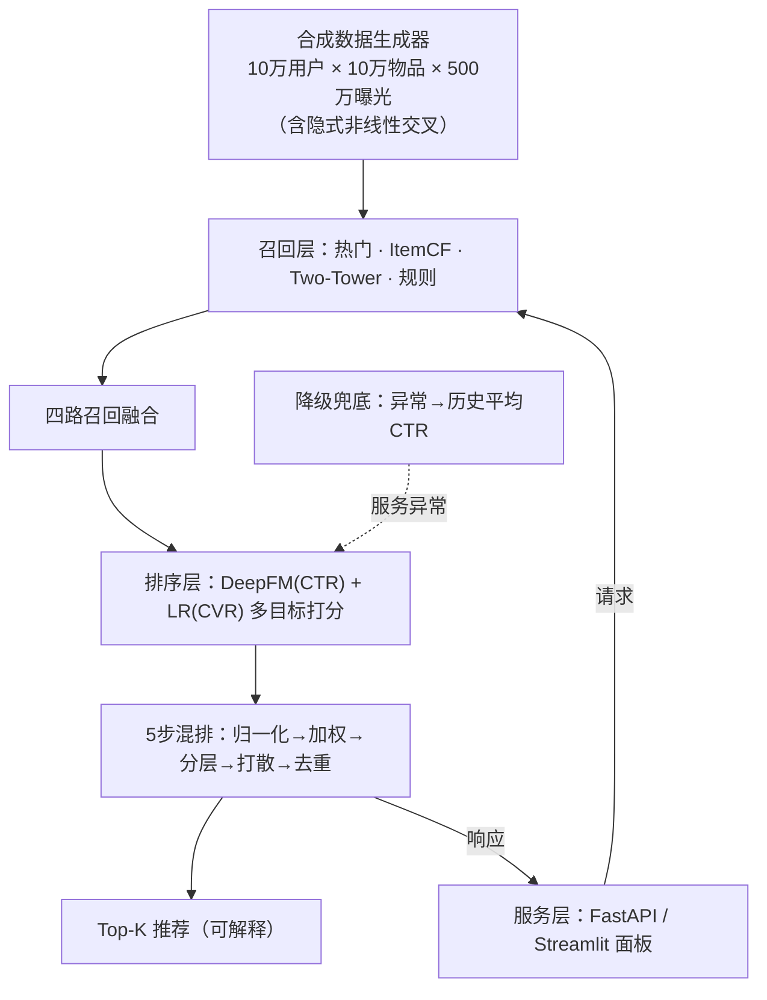

# AeroRec · 出行智能推荐中台

> 面向出行消费场景（机票 / 酒店 / 商城 / 营销 / 直播）的开源智能推荐中台。
> 工程化复现工业级推荐链路：**召回 → CTR 动态排序 → 降级兜底 → 服务化 → 可解释 → 真实 CTR 评估**。
> 本科 AI 出国申请作品 · 工程型 · 交叉学科（AI + 出行/交通）

[](https://www.python.org/)
[](LICENSE)
[](https://aerorec-tourism.streamlit.app)
[](https://streamlit.io/)
[](https://elijah-lin-dancer.github.io/AeroRec/)

> **快速体验**：[项目主页](https://elijah-lin-dancer.github.io/AeroRec/) · [交互 Demo（Streamlit Cloud）](https://aerorec-tourism.streamlit.app)
>
> **研究主线**（偏差传播诊断 + 去偏有效边界）：[tech report](docs/bias_report.md) · [可视化报告（HTML）](data/bias/report.html)
>
> <!-- ⚠️ 待办：上面两处 HF Spaces 链接目前写着预估地址 `spaces/<你的用户名>/AeroRec`。
>      创建 Space 后请把 `<你的用户名>` 替换为真实账号，并把 docs/index.html 第 187 行同步更新。 -->


---

## 背景与动机

出行类 App（机票、酒店、辅营）的核心增长杠杆之一是**个性化推荐中台**：在首页、会员中心、行程页等位置，
把"对的商品"在"对的坑位"推给"对的用户"。工业实践中，这与多品类混排、CTR 动态排序、服务降级、A/B 实验密不可分。

本项目**受工业实习中的推荐中台工程实践启发**，用一个**可复现的合成数据集**演示完整工程链路，
便于评审者一键运行、审阅与复现。**本项目不使用、也不声称使用任何真实业务数据。**

## 核心功能

- [x] 多场景推荐：航线 / 酒店 / 商城 / 营销 / 直播 五大类目混排
- [x] 热门兜底召回 + 物品协同过滤（ItemCF）召回基线
- [x] Two-Tower 向量召回（PyTorch 双塔 + 负采样）
- [x] 规则召回：里程兑换 / 里程票零库存 / 常驻地热门航线 / 多段行程优先返程
- [x] 四路召回融合（位置分加权 + 降级兜底）
- [x] 轻量特征库：集中产出召回 / 排序 / 冷启动共用特征（dense + sparse）
- [x] CTR 动态排序：归一化 → CTR 加权 → 分层排序 → 同品类打散 → 分页去重
- [x] DeepFM 排序模型（PyTorch，FM + DNN）
- [x] 降级兜底：CTR 服务超时 → 历史平均 CTR 兜底
- [x] 离线评估：LR vs DeepFM 的 AUC 对比 + 推荐列表真实 CTR 对比
- [x] 服务化 API（FastAPI：推荐 / 排序流程 / A/B）
- [x] 可解释面板（Streamlit 四页：推荐演示 / 排序流程 / 真实 CTR 对比 / 模拟 A/B）
- [x] 模拟 A/B 报告（多目标 CTR+CVR，点击率 / 转化率双提升）
- [x] **真实 CTR 口径评估 + Oracle 上界**（修正热门基线的平滑稀疏偏差，结论可引用）
- [x] **偏差传播诊断 + 去偏验证**（链路偏差传播矩阵 / IPS·SNIPS·DR 去偏 / 有效边界 `ESS/N≈0.358`，见 [tech report](docs/bias_report.md)）
- [x] **真实数据迁移性验证**：Criteo 真实 CTR 基准（100 万行，AUC **0.7733**）+ UCI Adult（**0.9183**）
- [x] 三档数据规模：`full`（10 万用户 × 10 万物品）、`lite`（2 万 × 2 万，2GB 内存在线）、`micro`（1 万 × 1 万，免费实例下限 690MB 内在线运行、离线训练 + numpy 推理）
- [x] 在线 Demo：GitHub Pages 项目主页 + Streamlit Community Cloud 交互面板
- [ ] demo 视频（30 秒录屏）

## 系统架构



## 快速开始

```bash
pip install -r requirements_full.txt   # 完整依赖（含 torch / sklearn，本地开发与离线复现用）
python -m src.pipeline_demo        # 数据 + 四路召回 + 融合 + 样例推荐
python -m src.eval.evaluate        # LR vs DeepFM AUC + 真实 CTR 对比 + Oracle 上界
python -m src.build_online_artifacts micro  # 离线生成在线权重（首次需先跑一次）
streamlit run app.py                    # 交互式 Demo，默认 micro 档（峰值约 297MB）
AEROREC_MODE=lite  streamlit run app.py # 轻量档（~0.93GB）
AEROREC_MODE=full  streamlit run app.py # 完整档（需 ~1.5GB 内存）
uvicorn src.serve.app:app --port 8000    # FastAPI 服务（推荐 / 排序流程 / A/B）
python -m pytest tests/ -q              # 冒烟测试（86 项）
python3.11 scripts/run_bias_experiments.py   # 偏差传播 + 去偏实验（产出 data/bias/*.json）
python3.11 scripts/build_bias_report.py      # 生成自包含 HTML 可视化报告
python3.11 scripts/validate_real_data_deepfm.py --dataset adult   # 真实数据迁移性验证（UCI Adult）
# 真实 Criteo 验证需本机下载数据放入 data/criteo/（见「真实数据验证」一节）
```

> **`requirements.txt` 为什么只有 numpy + streamlit**：Streamlit Community Cloud
> 只读取根目录的 `requirements.txt`。若把它写成完整依赖，Cloud 会安装 torch——
> 而 torch + sklearn + numpy + streamlit 的**框架基线已达 673MB**，超过免费实例
> **690MB 的内存下限**，留给数据的只剩 16.7MB，必然 OOM。
> 故根目录的 `requirements.txt` 是**部署专用**，完整依赖见 `requirements_full.txt`。

### 在线 Demo

- **项目主页（GitHub Pages）**：https://elijah-lin-dancer.github.io/AeroRec/
- **交互面板（Streamlit Community Cloud）**：https://aerorec-tourism.streamlit.app

## 数据与复现

### 为什么用合成数据，而不是公开数据集？

这是本项目最关键的一个设计决定，理由分三层，每一层都直接决定结论能否成立：

**1. 只有合成数据才有 ground-truth，才可能给出「可引用」的评估口径。**
本项目最硬的证据是 **Oracle 上界**（"模型收益已逼近候选空间极限"）与**不依赖平滑估计的真实 CTR 口径**，
而这两者都要求我们知道每个「用户 × 物品」的**潜在真实点击率**。真实数据集只提供观测到的点击（0/1），
拿不到真实 CTR 本身——于是既无法构造 Oracle 上界，也无法在原理上把「模型确实更好」与「基线被位置偏差削弱」
分离开。本项目把真实 CTR 定义为一个**已知的生成函数**（`src/config.py`，含"商务×早班机""价格敏感×低价"
等隐式交叉项），模型只能拿到原始特征、必须自行学出交叉，因此这套评估在受控条件下是严格成立的。

**2. 出行场景不存在可用的公开数据集。**
真实的机票 / 酒店 / 辅营数据同时受**用户隐私（PII）**与**商业机密**双重约束，不对外公开。
公开推荐数据集（如 MovieLens）属于电影评分域，直接搬用会丢掉「里程兑换、多段行程、商务×早班机」
这条出行特有的业务线——而那正是本项目相对通用推荐 demo 的差异点。

**3. 固定种子 = 一键复现，这是申请作品的基本要求。**
任何人 `git clone` 后执行 `python -m src.eval.evaluate`，都能得到与本文档**逐字节一致**的数字
（跨环境一致性验证见下「离线评估结果」一节）。一旦改用真实数据并涉及抓取与清洗，复现链条就会断裂。

> **代价如实写出**：合成数据无法覆盖真实分布的噪声、长尾、概念漂移与采样偏差。
> 因此本文档的指标衡量的是**方法在受控条件下的有效性**，而非**线上可迁移性**。
> 完整的局限清单见文末「诚实边界与局限性」。

### 数据长什么样

数据由 `src/data/synthetic_generator.py` 生成（固定随机种子，可一键复现）：

- **物品**：5 类目共 100,000 个（每类目 2 万），各带质量分 `quality`、现金价、里程价、出发/到达城市、航班时段、库存。
- **用户**：100,000 个，对各品类有亲和度 `aff_*`，附里程余额、常驻城市、价格敏感度、商务标签。
- **未来行程**：约 14.8 万条，支撑"多段行程按日期优先返程"等出行业务规则。
- **曝光日志**：500 万条，每条按"潜在真实 CTR"抽样点击、点击后按 CVR 抽样转化。

因已知潜在真实 CTR，离线评估（AUC、真实 CTR）具备可比性。

### 两档规模

| 档位 | 配置 | 规模 | 峰值内存 | 用途 |
|---|---|---|---|---|
| `full` | `src/config.py` | 10 万用户 × 10 万物品 × 500 万曝光 | ~1.5GB | 本地完整复现、**论文级可引用结果** |
| `lite` | `src/config_lite.py` | 2 万用户 × 2 万物品 × 100 万曝光 | ~0.93GB | 2GB 内存在线实例（在线训练） |
| `micro` | `src/config_micro.py` | 1 万用户 × 1 万物品 × 50 万曝光 | **~0.30GB** | 免费在线实例（内存下限 690MB，离线训练 + numpy 推理） |

三档**共用同一套算法代码**（`Mixer` / `DegradeRanker` / `simulate_ab` / `compare_rankers` 全部复用），
差异仅为数据规模与特征库实现（`lite`/`micro` 走纯 numpy 路径，规避 pandas/pyarrow 的额外内存开销）。
`lite` / `micro` 档的数值**仅供 Demo 演示**，可引用结论以 `full` 档为准。

切换方式：环境变量 `AEROREC_MODE=micro|lite|full`（默认 `micro`）。

### 在线 Demo 的一个工程取舍：把训练与推理解耦

先说清目标平台的**真实限额**（Streamlit Community Cloud 官方文档，2024-02 起未变）：

| 资源 | 官方限额 |
|---|---|
| CPU | **0.078 核**（下限）～ **2 核**（上限） |
| 内存 | **690 MB**（下限）～ **2.7 GB**（上限） |
| 存储 | 无下限 ～ 50 GB |
| GPU | **无** |
| 休眠 | 无流量 **12 小时**后休眠（访问即唤醒） |

> 注意这是**区间**不是固定值：限额按**应用（per-app）独立分配**，不是你账户下所有应用共享一个总池。
> 每个部署的应用都在自己的隔离环境里，单独享有 690MB–2.7GB 的上限；一个应用吃满内存**不会**挤占另一个应用。
> 所谓「共享」只指两层：① 平台底层物理资源是所有用户共用；② 每个人拿到的**上限相同**。
> 区间（如 RAM 690MB–2.7GB）是**单个应用**随平台负载被动态调度的结果：空闲时接近上限、繁忙时接近下限——这是平台级负载，不是你的应用互相争抢。
> 因此本项目的设计基准取**下限 690MB**（最坏情况），而非取 1GB 之类的「常见说法」。

在这个约束下，量了两种运行方式的**框架基线**（同进程加载，未含数据）：

| 进程内同时加载 | 框架基线 RSS | 690MB 下留给数据的空间 |
|---|---|---|
| torch + sklearn + numpy + streamlit（**解耦前**） | **673 MB** | **16.7 MB** → 必然 OOM |
| numpy + streamlit（**解耦后**） | **73 MB** | 617 MB |

**结论很清楚：只要 `import torch` 就固定吃掉约 500–650MB（随 wheel 类型与版本浮动：
CUDA 版明显大于 CPU 版），与数据规模无关。** 673MB 的框架基线在 690MB 的下限上
只剩 16.7MB——**连数据都装不下，继续缩数据是徒劳的**。

因此把**训练与推理解耦**：

1. **离线（本机）** 用 torch 训练 DeepFM(CTR) 与 LR(CVR)；
2. 权重**导出为 numpy 数组**（`python -m src.build_online_artifacts micro`，产物仅 29KB）；
3. **在线侧只加载权重**，用纯 numpy 复现前向计算（`src/rank/numpy_deepfm.py`、`src/rank/numpy_lr.py`），
   不依赖 torch / sklearn / pandas。

**端到端实测**（真实 streamlit 进程 + 浏览器驱动，非估算）：

| 阶段 | 进程 RSS |
|---|---|
| ① 仅启动 streamlit，无人访问 | 79.4 MB |
| ② 页面加载完（引擎与数据已就位） | 187.0 MB |
| ③ 跑完最重操作（真实 CTR 对比，200 用户 / Top-20） | **297.2 MB** ← 真实峰值 |

| | 解耦前（在线训练） | 解耦后（加载 numpy 权重） |
|---|---|---|
| 框架基线 | 673 MB | **73 MB** |
| 实测峰值 | 超出 690MB 下限 | **297 MB** |
| 相对 690MB 下限的余量 | 0.98×（**必然 OOM**） | **2.3×** |
| 启动耗时 | 数十秒（需在线训练） | **~1 s** |

**数学等价性已逐样本校验**：PyTorch 与 numpy 前向的最大偏差为 **1.19e-07**；
且重构后 `compute_true_ctr` 与重构前实现**逐位一致**（最大偏差 0.00e+00）。
即：在线演示的**仍是同一个已训练模型**，只是换了一种运行时执行。

> 这类「先量清楚约束在哪、再决定动哪一层」的判断，本身就是本项目想展示的工程能力。

**算力侧同样有余量**：最重的操作是「模拟 A/B」（2000 用户），本机实测 **1.87s**。
即便按最坏的 0.078 核折算（约 12.8× 减速）也在 **24s** 量级，不会触发超时；
单次推荐 **1 ms**、冷启动 **0.53s**，交互体感不受影响。

```
python -m src.build_online_artifacts micro   # 离线生成/刷新在线权重（需 torch，约 2 分钟）
```

## 方法

1. **召回（已完成）**：热门兜底 + ItemCF + Two-Tower 向量召回 + 出行规则召回，四路融合产出候选集。
2. **排序（已完成）**：复刻工业 5 步流程——分数归一化 → CTR 加权 → 分层排序 → 同品类打散 → 分页去重；CTR 模型为 DeepFM（PyTorch）。
3. **降级（已完成）**：CTR 服务超时 → 降级为历史平均 CTR 兜底，保证核心链路不挂。

## 离线评估结果（受控合成实验）

### ① CTR 模型 AUC（测试集 6 万样本）

| 模型 | AUC |
|---|---|
| Logistic Regression | 0.7421 |
| **DeepFM** | **0.8019**（+6.0pp） |

DeepFM 的 FM/DNN 能自动学出数据中的隐式非线性交叉（价格敏感×低价、商务×早班机、里程契合），
因此显著优于线性 LR。**模型只能拿到原始特征，交叉需自行学习**——此设计明确标注为受控实验设置。

### ② 可引用结论：真实 CTR 口径 + Oracle 上界

> **为什么不用「模拟 A/B 的 +18.9%」作为主结论？**
> 热门基线按「历史日志的**贝叶斯平滑 CTR**（α=5）」排序，而日志是**随机曝光**生成的：
> 曝光次数少的物品偶然被点击一次，平滑 CTR 就被严重高估（α=5 压不住这种噪声）。
> 完整档实测：热门榜 top200 **平滑 CTR = 0.6231** vs **真实 CTR = 0.2528**（**偏差 +0.37**），
> 平滑榜 top10 与真实 CTR top10 仅重合 **2/10**。这层稀疏性偏差会让热门基线在模拟中「表现变差」，
> 从而**高估**实验组增益。因此本项目同时给出下面这套**不依赖任何平滑估计**的口径。

**真实 CTR 口径**（直接用已知的潜在真实 CTR 计算各方法 Top-K 列表的平均点击率，100 用户、Top-10）：

| 方法 | 平均真实 CTR | 相对热门 | 占 Oracle 上界 |
|---|---|---|---|
| 随机（下界参照） | 0.1652 | -66.4% | 23.1% |
| 热门（工业常用基线） | 0.4922 | — | 68.8% |
| **DeepFM + 多目标混排** | **0.6323** | **+28.5%** | **88.4%** |
| Oracle 上界（候选池最优） | 0.7153 | +45.3% | 100% |

**Oracle 上界怎么构造的**：池 = 热门候选 ∪ 规则候选 ∪ 3000 个随机物品，
在池内按**该用户的真实 CTR** 降序取 Top-K。池**必须包含其他方法的结局**，
否则 Oracle 不构成真正的上界——本项目第一版曾误用「全局平均真实 CTR 排序」，
结果退化成热门榜的变体（与 DeepFM 打平），已修正为逐用户候选池口径。

**结论**：DeepFM 多目标排序相对热门基线提升 **+28.5%**，达到理论上界的 **88.4%**，
即模型的收益已经接近候选空间所能提供的极限。该数字**可引用**，因为它不依赖任何有偏估计。

> **关于数值可复现性（重要）**：本节所有数字都由
> `python -m src.eval.evaluate` 直接产出，且已在两套完全不同的依赖环境下
> （numpy 2.3.5 / torch 2.10 与 numpy 2.4.6 / torch 2.14）**逐字节复现**。
> 做到这一点需要一处容易遗漏的修复：`DeepFM` 的权重初始化（xavier / normal）
> 必须发生在 `torch.manual_seed(SEED)` **之后**——见 `src/rank/trainer.py`。
> 修复前，网络初值取自进程全局 RNG 的残余状态，同一份代码在不同环境下
> AUC 会漂移约 0.004、相对热门提升会在 +22.9% ~ +33.7% 之间跳动。

> **一个额外的工程发现**：混排阶段的「基础分权重 `w_base`」实测会**拉低**效果。
> 候选池已由热门召回 + 规则召回构成，热度信息已经体现在候选集里；
> 若再在混排阶段叠加一次基础分，等于把热门偏差二次注入排序结果。
> 实测（真实 CTR 口径）：`w_base=0.4` → +6.3%，`w_base=0.2` → +17.2%，**`w_base=0.0` → +20.1%**。
> 故本项目默认 `w_base=0.0`，仅以 CTR（多目标得分）驱动混排，但**保留**第 4 步同品类打散与第 5 步去重。

### ③ 参考：模拟在线 A/B（口径受限，仅供形式对照）

| 指标 | 对照组（热门） | 实验组（DeepFM+混排） | 提升 |
|---|---|---|---|
| 点击率 CTR | 0.519 | 0.618 | +18.9%（p<0.001） |
| 转化率（转化/曝光） | 0.191 | 0.227 | +18.8%（p<0.001） |

> ⚠️ 上表为**模拟**口径，其热门基线受上述平滑稀疏偏差削弱，**增益被高估**，
> 故仅保留以展示工业 A/B 的形式（曝光 / 点击 / 显著性检验）。
> **对外引用请使用 ② 的真实 CTR 口径。**

### ④ 研究主线：偏差传播诊断与去偏有效边界

> 完整版见 **[docs/bias_report.md](docs/bias_report.md)**（tech report 级）；
> 可视化版见 **[data/bias/report.html](data/bias/report.html)**（自包含单文件，21 KB，含内联 SVG，
> 零外链零脚本，可离线打开；GitHub 上点开后可用 [htmlpreview](https://htmlpreview.github.io/) 或在本地直接打开）。

本项目的**独有资源**是可控 ground-truth（`compute_true_ctr` 是解析已知的生成函数）——
真实数据集只能*估计*偏差，这里可以*精确测量*，且曝光策略自造、propensity 是**闭式已知**的。
这使「去偏估计能否还原真值」可以被严格检验。

**结论一：偏差的主要危害是排序反转，不是水平偏移。**

链路偏差传播矩阵（60 物品、300 请求 × 5 坑位、α=5）：

| 曝光偏斜 τ | 排序级 spearman（越接近 1 越好） | 曝光最少 / 最多 | KL | Gini |
|---|---|---|---|---|
| 0.0 | +0.7834 | 13 / 33 | 0.0195 | 0.1102 |
| 0.5 | +0.6935 | 14 / 36 | 0.0298 | 0.1395 |
| 1.0 | +0.5442 | 6 / 58 | 0.1100 | 0.2647 |
| 2.0 | −0.1750 | 2 / 95 | 0.3412 | 0.4551 |
| 3.0 | **−0.5717** | **0 / 159** | 0.6985 | 0.6240 |

**spearman 从 +0.78 一路跌到 −0.57，符号反转**——排行榜被搞反了。
只看「平均 CTR 偏高多少」会得出「偏差可控」的结论，却完全看不见排序级的破坏。

**结论二：IPS 纠正的是「估计目标」，不是「坏估计」。**

naive 池化 CTR 对 `T_exp = Σ truth·π`（曝光分布下的平均真实 CTR）**几乎完全无偏**（误差 ≤ 0.008）。
看似存在的偏差来自 `T_exp ≠ T_pop = mean(truth)`——即 estimand 改变了，而非 estimator 出错。
**只有当需要跨策略比较或离线评估新策略时，去偏才是必要的。**

**结论三：去偏的有效边界由 propensity 动态范围决定，而非偏差强度。**

实测**边界 `ESS/N ≈ 0.358`**：低于该值时 IPS/SNIPS 的方差代价超过纠偏收益，收益转负。

| π 范围 | `π_max/π_min` | **ESS/N** | naive err | SNIPS err | gain |
|---|---|---|---|---|---|
| [1, 1] | 1 | 1.0000 | 0.0020 | 0.0020 | +0.0000 |
| [0.5, 1.5] | 3 | 0.9052 | 0.0020 | 0.0025 | −0.0005 |
| [0.05, 2.0] | 40 | **0.3585** | 0.0020 | 0.0040 | −0.0020 ← 边界 |
| [1e-4, 2.0] | 20 000 | 0.0063 | 0.0020 | 0.0328 | −0.0309 |
| [1e-6, 2.0] | 2 000 000 | 0.0033 | 0.0020 | 0.0536 | −0.0516 |

注意 `naive err` **恒为 0.0020**——边界说的不是「naive 何时开始不准」，
而是「花方差代价去纠正那 0.002，何时开始不划算」。

`ESS/N` 是本项目给出的**唯一可落地的判据**：它只需 propensity 与样本量，
**不需要 ground-truth**——而「偏差有多大」在真实系统里恰恰不可测。
落地接口 `ess_warning_from_log(log, threshold=0.358)`。

**结论四：偏差的二次注入有符号。** 混排基础分 `w_base` 若注入的是**已在候选集中的热度**，有害（项目默认取 0.0）；
若注入**独立于现有信号的信息**，有益。这统一解释了项目早期的 `w_base` 例外。

> **被实测推翻的两个假设（如实写出）**：
> ① 原以为「τ 越大去偏越容易亏本」——实测**正相反**，τ 越大去偏赚得越多（+0.07 → +0.16），
> 因为 τ 只拉大 `T_exp` 与 `T_pop` 的差距，而 propensity 是闭式已知的。真正的边界是 π 动态范围。
> ② 原以为「π 越集中 ESS 越小」——实测 ESS 由**最小的 π** 主导：`π=[0.99, 其余均分]` 的 ESS 高达 499，
> 而 `π=[1e-8, 其余均分]` 的 ESS = 1。

> **局限**：0.358 是在本项目合成数据的规模与先验下测出的，**不可直接迁移到其他系统**（可迁移的是方法）。
> 且本实验的 propensity 为闭式已知，真实系统需估计 propensity，会引入本实验不存在的误差，**实际边界会更严苛**。

## 目录结构

```
src/
  config.py              全局配置（full 档）
  config_lite.py         轻量档配置（继承 full，仅覆盖规模）
  config_micro.py        极轻档配置（继承 lite，仅覆盖规模）
  config_scale.py        档位解析（micro / lite，按 AEROREC_MODE 选择）
  build_online_artifacts.py  离线训练 + 导出 numpy 权重（需 torch）
  data/synthetic_generator.py      合成数据生成器（pandas 路径，full 档）
  data/synthetic_generator_lite.py 纯 numpy 生成器（lite 档，低内存）
  feature/store.py             轻量特征库（full 档）
  feature/lite_store.py        特征库 numpy 实现（lite / micro 档）
  data/generator_common.py     pandas-free 的生成基础量与真实 CTR 公式
  recall/baselines.py          热门 + ItemCF 召回
  recall/two_tower.py         Two-Tower 向量召回
  recall/rule.py              出行规则召回（里程 / 多段行程）
  recall/fusion.py            多路召回融合
  rank/deepfm.py              DeepFM 排序模型（PyTorch，离线训练）
  rank/trainer.py             CTR 训练器（PyTorch）
  rank/numpy_deepfm.py        DeepFM 的纯 numpy 前向（与 PyTorch 数值等价，在线用）
  rank/numpy_lr.py            LR + OneHot 的纯 numpy 实现（在线用，免 sklearn）
  rank/mixer.py               5 步混排
  rank/degrade.py             降级兜底
  eval/metrics.py             离线指标
  eval/evaluate.py            LR vs DeepFM AUC + 真实 CTR 对比 + Oracle 上界
  eval/ab.py                  模拟 A/B + compare_rankers（真实 CTR 口径）+ 偏差表
  serve/engine.py             推荐引擎（full 档）
  serve/engine_lite.py        推荐引擎（lite 档，在线训练）
  serve/engine_micro.py       推荐引擎（micro 档，加载 numpy 权重，无 torch/sklearn）
  serve/app.py                FastAPI 服务
  app.py                      Streamlit 交互 Demo（根目录，支持 lite/full 切换）
  bias/policy.py              曝光策略与闭式 propensity（均匀 / 热度^τ / 位置 1/rank^η）
  bias/injectors.py           偏差注入器（build_biased_log 为去偏实验唯一数据入口）
  bias/metrics.py             偏差度量：曝光分布（KL/Gini）+ 统计偏差 + 排序偏差
  bias/propagation.py         链路偏差传播矩阵 + 混排二次注入
  bias/estimators.py          去偏估计量 IPS/SNIPS/DR + 交叉拟合 + ESS + π 约定检测
  bias/boundary.py            去偏有效边界扫描 + ess_warning_from_log 落地接口
  bias/report.py              自包含 HTML 报告生成（内联 SVG，零依赖）
  data/criteo.py              Criteo 真实 CTR 加载器（parquet / DAC 文本双格式）
  data/adult.py               UCI Adult 真实数据加载器（快速自检）
scripts/validate_real_data_deepfm.py  真实数据迁移性验证（Criteo / Adult）
tests/test_data.py         数据 / 特征 / 召回 冒烟测试
tests/test_rank.py         排序层 / 混排 / 降级 冒烟测试
tests/test_ab.py           模拟 A/B 冒烟测试
tests/test_bias_*.py       偏差诊断 / 去偏估计 / 边界 / 报告 测试（6 文件 64 用例）
tests/test_criteo*.py      Criteo 加载器单测（构造样本 + 真实 parquet 兼容性）
tests/test_real_data.py    UCI Adult 加载器测试
docs/bias_report.md          偏差传播诊断与去偏验证 tech report
data/bias/                   偏差实验产物（propagation/injection/boundary.json + report.html）
data/real_validation/        真实数据验证结果（Criteo 100 万 / 20 万行 + Adult）
artifacts/micro/           离线预训练的在线权重（numpy，约 29KB）
requirements.txt           部署依赖（仅 numpy + streamlit，Streamlit Cloud 读这个）
requirements_full.txt      完整依赖（含 torch / sklearn / pandas，本地开发与离线复现）
```

## 诚实边界与局限性

### 诚实边界

- 数据为本项目**合成**（受控实验），仅用于演示工程链路；不涉任何真实业务数据，也不与任何真实企业系统关联。
- 数据生成公式中注入了隐式非线性交叉项，用于让深度模型可学；模型只能拿到原始特征，交叉需自行学习——此设计明确标注为受控实验设置。
- CTR / 召回模型使用标准模型（scikit-learn / PyTorch 实现的 Two-Tower、DeepFM 等均为已有方法的实现），本项目**不提出新算法**。
- 实习经历仅作为项目动机来源（业务规则与流程启发），实习中未涉及深度排序模型的训练。

### 已知局限

主动列出，避免被误读：

- **合成指标向真实出行流量的外推性仍未证明，但框架迁移性已在两个真实公开数据集上验证。**
  同一套 `DeepFM`（与合成链路完全一致的实现）在两份真实、公开、可引用的数据上取得验证 AUC：
  **Criteo Display Advertising Challenge**（真实 CTR，13 稠密 + 26 稀疏，全量 100 万行，验证 AUC **0.7733**，
  见 `data/real_validation/result.json`）与 **UCI Adult / Census Income**（同构 `(dense, sparse)→二元`，
  验证 AUC **0.9183**）。两者证明模型实现能在真实数据上学到信号。
  **然而**这两份数据**都不是出行域流量**；合成指标（AUC 0.8019、相对热门 +28.5%）
  向真实出行流量的外推性**仍待验证**。
- **Criteo 上深度交叉项未显现出明显优势（如实记录）。** 100 万行档 DeepFM 验证 AUC **0.7733**，
  同数据 LR 基线 **0.7716**，**差距仅 0.0017**——在单次运行下难以排除随机性（未做多种子方差估计）。
  因此本节只声称「同一份实现能处理真实 CTR 数据、学到强信号（≫ 0.5）」，
  **不声称**深度交叉项在真实数据上带来增量。Criteo 以高基数稀疏类别特征为主，
  线性模型在此类任务上本就接近强基线，这一结果与文献观察一致。
- **A/B 为离线反事实重放，非真实在线实验。** `simulate_ab` 在合成日志上重放，
  不含网络效应、用户反馈循环与长短期收益的差异，仅用于验证统计流程（两比例 z 检验）实现是否正确。
- **出行业务规则的收益未经真实数据检验。** 「里程兑换」「多段行程优先」等规则来自实习启发，
  在合成数据上自洽，但其真实业务价值需线上实验确认。
- **训练预算必须按「梯度更新次数」设定，不能随数据规模线性缩放。** 深度模型收敛取决于
  **梯度更新次数**，与样本量无关。本项目早期曾把 lite 档 epoch 写死，导致在 1.2 万样本上只做了约 60 次更新、
  AUC 跌到 0.5109（相对热门 −57.3%）——典型的"样本规模自适应 ≠ 训练量自适应"静默欠拟合。
  修复后用 `plan_epochs(target_updates=400)`（`src/rank/trainer.py`）反推 epoch，lite 回到 +13.9%。
  教训：同一套模型跑多档位时，训练预算要用"目标更新次数"统一约束，否则小规模档位会悄悄欠拟合。
- **本项目的贡献是「工程链路复现 + 评估口径的诚实性」，不是算法创新。** 这一点在「方法」一节已声明。
- **偏差实验的 propensity 为闭式已知，且边界数值不可迁移。** 本项目的去偏实验建立在「曝光策略自造、
  故 propensity 是策略参数的确定性函数」这一前提上——这是能精确测量去偏误差的原因，
  但真实系统必须*估计* propensity，会引入本实验里不存在的误差，**实际有效边界会更严苛**。
  实测边界 `ESS/N ≈ 0.358` 是在本项目合成数据的规模与先验下得到的，
  **可迁移的是方法（用 ESS/N 作预警），不是这个数值**。详见 [docs/bias_report.md](docs/bias_report.md)。
- **偏差实验规模有限、且未覆盖用户侧偏好偏差。** 传播矩阵为 60 物品 × 300 请求 × 5 坑位，
  边界实验 `n_records = 20000`；且仅建模曝光/位置偏差，未涉及「同一用户内跨物品的选择偏差」。

## 待办（Roadmap）

### 已完成

- [x] W2：Two-Tower 召回 + 规则召回 + 召回融合
- [x] W3：DeepFM 排序 + 5 步混排流程 + 降级策略 + 离线评估（AUC / 真实 CTR）
- [x] W4：FastAPI 服务化 + 可解释面板（Streamlit）+ 模拟 A/B 报告
- [x] W5–W6：架构图 / 复现文档 / 量化结果 / 在线 Demo（GitHub Pages + Streamlit Cloud）
- [x] W7：评估口径修正 —— 发现并修正 A/B 基线稀疏性偏差、混排 `w_base` 热度二次注入
- [x] W8：可复现性修复（训练随机性未播种）+ 依赖版本约束 + 诚实边界披露
- [x] W9：真实数据一致性检查 —— 用 UCI Adult（真实 `(dense,sparse)→二元` 基准）验证同一份 `DeepFM`
  在真实数据上仍能学到信号（验证 AUC **0.9183**），排除「模型实现本身有问题」
- [x] **W10：研究主线 —— 偏差传播诊断 + 去偏验证**
  - M1 曝光策略与闭式 propensity（50 万 × 3 坑位下 π 求和 = 1.0，经验频率偏差 0.00033 < 1 SE）
  - M2 偏差度量与既有现象复现（平滑 CTR 0.5220 vs 真实 0.4476）
  - M3 链路偏差传播矩阵（**排序反转 +0.7834 → −0.5717**）+ 二次注入自检
  - M4 去偏估计量 IPS / SNIPS / DR（含 π 两种约定的检测与告警）
  - M5 去偏有效边界（**`ESS/N ≈ 0.358`**，含 60 种子平均与噪声判据）
  - M6 自包含 HTML 可视化报告 + 本文档
  - **产出**：[docs/bias_report.md](docs/bias_report.md)、`src/bias/`（6 模块）、`data/bias/report.html`

- [x] **W11：真实数据验证（路径 B）—— 用 Criteo 真实 CTR 基准验证 DeepFM 迁移性**
  - Criteo Display Advertising Challenge（13 稠密 + 26 稀疏 → p(click)，与本项目排序器**完全同构**）
  - 100 万行：验证 AUC **0.7733**；20 万行：**0.7583**（规模对照，两次独立运行逐位一致）
  - 加载器支持 parquet 与 DAC 文本两种格式，模型**零改动**
  - 保留 UCI Adult 作快速自检（**0.9183**）

### 真实数据验证（路径 B，已完成）

**主线基准：Criteo Display Advertising Challenge**——CTR / DeepFM 论文的标准真实基准，
任务与本项目排序器**完全同构**（13 稠密 + 26 稀疏 → p(click)），接口零改动。
数据来源为 HuggingFace `eldieguinpo/criteo-1M`（Criteo DAC 均匀抽样的 100 万行）。

| 指标 | 数值 |
|---|---|
| 训练 / 验证样本 | 900,000 / 100,000 |
| 验证集正类率 | 0.2512（真实 Criteo 点击率） |
| **DeepFM 验证 AUC** | **0.7733** |
| LR 基线 验证 AUC | 0.7716 |
| 常数基线 AUC | 0.5000 |
| 训练预算（梯度更新次数） | 3,516 |

> **数据规模效应**：同一脚本 20 万行得 AUC 0.7583、100 万行得 **0.7733**——高基数稀疏特征需要
> 足够样本才能学稳。20 万行结果保留在 `data/real_validation/result_criteo_200k.json` 作为对照。

> **可复现性**：20 万行与 100 万行两档均**独立重跑并逐位复现**（0.7583 / 0.7733）。
> 唯一非确定性来自 LR 基线——它在弱 CPU 上 150 次迭代未完全收敛，
> 故在结果中标注为"未收敛的对照基线"，不代表 DeepFM 有抖动。

**结论的口径（保守）**：DeepFM 在真实 Criteo 上 AUC **0.7733 ≫ 0.5**，即**同一份实现能处理真实 CTR 数据**。
但与 LR 基线（0.7716）**仅差 0.0017**，不足以支撑「深度交叉项在真实数据上有增量」——
该说法需要多种子方差估计才能成立，本项目未做，故**不声称**。

**Criteo 接入**：`src/data/criteo.py` 同时支持两种真实格式（按扩展名分派）——
parquet（`criteo-1M`：`label, I1..I13, C1..C26`，稠密缺失 `NaN`、稀疏整数哈希码）
与 DAC 文本（`train.txt`：tab 分隔，缺失为空串）。
预处理：稠密缺失→0、`log1p`、Z-score（仅训练集统计量）；稀疏按字段建频率词表、低频/OOV→0。
解析逻辑已用构造样本 + 真实 parquet 双路单测（`tests/test_criteo.py`、`tests/test_criteo_real.py`）。

一键运行：

```bash
# 1) 获取数据（本沙箱无法直连官方源，需本机下载后放入 data/criteo/，该目录已 gitignore）
#    - 推荐：HuggingFace eldieguinpo/criteo-1M -> criteo_1M.parquet（约 45MB / 100 万行）
# 2) 验证（约 161s / 100 万行）
python scripts/validate_real_data_deepfm.py --dataset criteo \
    --criteo-path data/criteo/criteo_1M.parquet --criteo-rows 1000000
```

> **工程提示**：本沙箱 CPU 配额仅 4 核，而 PyTorch 默认按物理核数（32）开线程，严重超订会让每步
> 耗时飙到秒级。验证脚本已内置线程上限（`AEROREC_THREADS`，默认 4）——真实环境里常见但易忽略的坑。
> 另：LR 基线全程保持 scipy 稀疏（26 字段 one-hot 稠密化会直接 OOM）。

**诚实边界**：Criteo 仍**非出行域流量**，它只是最接近的公共代理 + 最被认可的 CTR 基准，
**不代表在出行真实流量上验证过**。

**数据获取的说明**：Criteo 官方源（ailab / S3 `criteo-labs` / `go.criteo.net`）在构建沙箱中均不可达
（404 或重定向后超时），HuggingFace CDN 亦超时，故数据文件由**本机下载后上传**。
选择 `eldieguinpo/criteo-1M` 是因为它与官方 DAC 同源（均匀抽样镜像），且体量适合本项目。

### 可能的后继方向

- 把偏差诊断接入真实数据链路：用估计出的 propensity 复跑边界实验，量化「propensity 估计误差」对边界的影响。
- 用户侧选择偏差建模（同一用户内跨物品的偏好偏差），补齐当前单物品域的缺口。
- **为路径 A 配真实数据**：正确选择是 **Coat**（Schnabel et al. 2016，同时含"自选偏差集"与
  "随机无偏集"，是去偏研究的标准基准）或 **Open Bandit Dataset**（ZOZO，含真实 propensity）。
  MovieLens **不适合**——它未记录曝光策略与 propensity，无法做 IPS 去偏验证。
- 备选：服务工程深度（P99 延迟 / QPS 曲线 / 冷启动 / 增量特征更新）。属工程信号强化，与研究向申请收益有限。

---

*注：本文档随开发推进更新，勾选项为已完成模块。*
