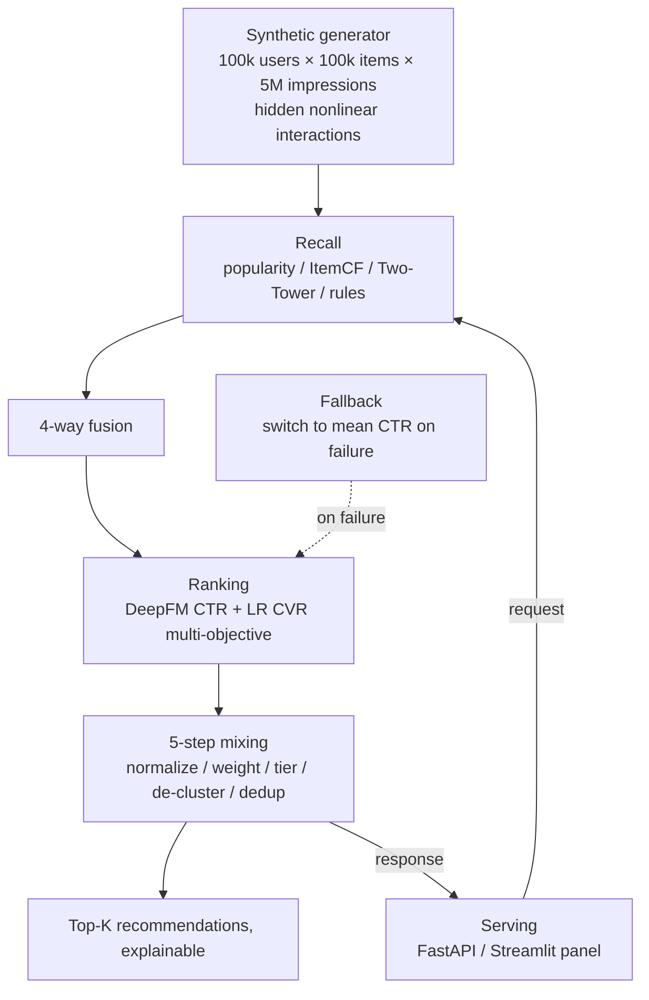

# AeroRec

> 🌐 English | [简体中文](README.zh.md)

**An end-to-end travel recommendation platform — 4-way recall, DeepFM ranking, 5-step mixing, serving API and a bilingual panel — carrying a research thread that makes exposure bias *measurable* instead of guessed.**

[](https://github.com/Elijah-Lin-Dancer/AeroRec/actions/workflows/repro.yml)
[](https://www.python.org/)
[](LICENSE)
[](https://aerorec-tourism.streamlit.app)
[](https://elijah-lin-dancer.github.io/AeroRec/)
[](https://doi.org/10.20944/preprints202610.2582.v2)
[](https://doi.org/10.5281/zenodo.24003810)

AeroRec reproduces an industrial recommendation chain on a **reproducible synthetic dataset**: 4-way recall → fusion → DeepFM/LR multi-objective ranking → 5-step mixing → FastAPI service and a bilingual (EN / 中文) 7-page panel. The data generator is analytical, so the latent CTR and the logging propensity are **known in closed form** — bias can be measured exactly, not estimated, and every claim on this page has a number behind it.

**[Live demo](https://aerorec-tourism.streamlit.app)** · **[Project homepage](https://elijah-lin-dancer.github.io/AeroRec/)** · **[Preprint](https://doi.org/10.20944/preprints202610.2582.v2)** · **[Tech report](docs/bias_report.md)**

> **Where this came from** — It began with an internship. Working on a travel product at an airline gave me my first close look at the constraints a recommender faces in production; once it ended, I carried back the questions I had no time to chase — how large exposure bias really is, and when it is genuinely worth correcting. This repository answers them with measurement rather than intuition.

---

## 🎯 Why this one

1. **The whole chain runs, not just the model.** Popularity / ItemCF / Two-Tower / rule recall → position-weighted fusion → DeepFM (CTR) + LR (CVR) → normalize / weight / tier / de-cluster / dedup → REST API and a 7-page panel. `151` tests, `ruff` + `mypy` green.
2. **Bias is measured against a known truth.** With closed-form ground truth, the ranking damage shows up plainly: Spearman **+0.8665 → −0.5054** as exposure skew grows — the leaderboard inverts even though the mean CTR looks fine. Debiasing has a measurable boundary at **ESS/N ≈ 0.358**, and it needs no ground truth to compute.
3. **Numbers reproduce byte-for-byte.** 7 bias experiments in **19 s on numpy only**; committed artifacts are re-derived in CI and diffed (`git diff --exit-code`); all **207** numeric claims in the paper are audited against artifacts with **0 difference**.
4. **It ships inside a 690 MB memory budget.** Training and inference are decoupled: torch offline, pure-numpy forward online (max deviation **1.19e-07**), **no torch at serve time** — asserted in CI. Online: P50 **0.71 ms** / P99 **0.93 ms**, **1379 QPS**, **129 MB** RSS.

## 📸 In action

<p align="center">
  
</p>
<p align="center">
  
  
  
  
</p>

> The panel opens on **Overview** — what the project does, the four headline numbers and the citation, in one screen. The rest is the live demo, the bias sweep and the model page; the last shot is the same page in Chinese. The UI is bilingual throughout (sidebar toggle, English by default).

## 🧭 Architecture



Training and inference are decoupled: torch trains offline and exports numpy weights; the online path is a pure-numpy forward pass — **no torch at serve time**.

## ✨ Feature list

- [x] Multi-category mixing: flights / hotels / retail / marketing / live-streaming
- [x] Popularity fallback recall + item-based collaborative filtering (ItemCF) baseline
- [x] Two-Tower vector recall (PyTorch, with negative sampling)
- [x] Rule recall: mileage redemption / zero award inventory / home-base top routes / return-first multi-leg trips
- [x] 4-way recall fusion (position-weighted + degradation fallback)
- [x] Lightweight feature store shared by recall / ranking / cold start (dense + sparse)
- [x] CTR-based dynamic ordering: normalize → weight → tier → de-cluster → dedup per page
- [x] DeepFM ranker (PyTorch, FM + DNN)
- [x] Degradation fallback: on CTR-service timeout, fall back to historical mean CTR
- [x] Offline evaluation: LR vs DeepFM AUC + true-CTR comparison of ranked lists
- [x] Serving API (FastAPI: `/health` `/recommend` `/explain` `/ab`)
- [x] Streamlit panel, **7 pages, bilingual EN / 中文**
- [x] Online inference benchmark: cold-start init ≈ 0.08 s, single-thread P50 ≈ 0.7 ms / P99 ≈ 1 ms, peak RSS ≈ 129 MB (micro tier)
- [x] Simulated A/B (multi-objective CTR + CVR, offline counterfactual replay)
- [x] **True-CTR protocol + oracle upper bound** (no smoothing estimates involved; citable)
- [x] **Bias-propagation diagnosis + debiasing validation** (propagation matrix / IPS·SNIPS·DR / boundary `ESS/N ≈ 0.358`)
- [x] **Real-data transferability**: Criteo 1 M rows AUC **0.7733**, UCI Adult **0.9183**
- [x] Three data tiers: `full` / `lite` / `micro` — same code, scale only
- [x] Live demo: GitHub Pages homepage + Streamlit Community Cloud

## ⚡ Quick start

```bash
# 30-second demo — numpy + streamlit only, no torch, ~0.3 GB
pip install -r requirements.txt
streamlit run app.py

# Full reproduction — adds torch / scikit-learn / pandas
pip install -r requirements_full.txt
python -m src.eval.evaluate              # LR vs DeepFM AUC + true-CTR protocol + oracle bound
python scripts/run_bias_experiments.py   # 7 bias experiments -> data/bias/*.json (~19 s, numpy only)
python -m pytest -q                      # 151 tests
```

| Command | What it does | Needs |
|---|---|---|
| `python -m src.pipeline_demo` | Data → 4-way recall → fusion → sample recommendations | full deps, ~5 M-row log |
| `python -m src.eval.evaluate` | AUC comparison + true-CTR ranking + oracle upper bound | full deps |
| `python -m src.build_online_artifacts micro` | Train offline, export numpy weights to `artifacts/micro/` | torch |
| `uvicorn src.serve.app:app --port 8000` | REST service: `/health` `/recommend` `/explain` `/ab` | full deps |
| `python scripts/run_bias_experiments.py` | Propagation / injection / boundary / sweep / user-side experiments | numpy only |
| `python scripts/build_bias_report.py` | Self-contained HTML report (inline SVG, zero JS) | numpy only |
| `python scripts/bench_inference.py --mode micro` | Latency / QPS / RSS benchmark → `data/bench.json` | numpy only |
| `python scripts/audit_paper_numbers.py --strict` | Re-check all 207 paper numbers against artifacts | numpy only |
| `python scripts/make_paper_figures.py` | Regenerate the 6 paper figures from artifacts | matplotlib |
| `python scripts/validate_real_data_deepfm.py --dataset adult` | Real-data transferability check (also `--dataset criteo`) | full deps |

**Three data tiers**, switched by `AEROREC_MODE=micro|lite|full` (default `micro`):

| Tier | Scale | Peak memory | Purpose |
|---|---|---|---|
| `full` | 100 k users × 100 k items × 5 M impressions | ~1.5 GB | Paper-grade, citable results |
| `lite` | 20 k × 20 k × 1 M | ~0.93 GB | 2 GB instance, trains online |
| `micro` | 10 k × 10 k × 500 k | **~0.30 GB** | Free instance (690 MB floor), offline training + numpy inference |

All three tiers share the same algorithm code; only data scale and the feature store differ.

## 📊 Results at a glance

**Offline AUC (synthetic, 60k test samples)**

| Model | AUC |
|---|---|
| Logistic Regression | 0.7421 |
| **DeepFM** | **0.8019** (+6.0 pp) |

**True-CTR protocol (no smoothing involved; 100 users × Top-10)**

| Method | Mean true CTR | vs popularity | Of oracle bound |
|---|---|---|---|
| Random (lower reference) | 0.1652 | −66.4% | 23.1% |
| Popularity (common baseline) | 0.4922 | — | 68.8% |
| **DeepFM + multi-objective mixing** | **0.6323** | **+28.5%** | **88.4%** |
| Oracle upper bound (pool-best) | 0.7153 | +45.3% | 100% |

Every number above is produced directly by the two commands in Quick start (`python -m src.eval.evaluate`, `python scripts/run_bias_experiments.py`).

<details>
<summary>Research-line results (bias propagation / boundary / user side)</summary>

- The primary damage of exposure bias is **rank inversion**: Spearman **+0.8665 → −0.5054** as exposure skew grows (τ = 3, p < 0.001) — mean CTR looks fine while the leaderboard quietly flips.
- The debiasing boundary sits at **ESS/N ≈ 0.358**: below it, variance cost exceeds the correction gain; a 33× scale-up and 30 → 250 seeds move the boundary by only 0.005.
- User-side self-selection must be modeled at the user–item level: naive CTR inflates **2.5×** (0.2811 → 0.7025), and debiasing at the wrong granularity leaves a residual of +0.222.
- Full tables and derivations: [docs/tech-report.md](docs/tech-report.md) and the [self-contained HTML report](data/bias/report.html).

</details>

<details>
<summary>How the oracle is built / why not the smoothed protocol / what the simulated A/B is</summary>

- **Oracle construction**: pool = popularity candidates ∪ rule candidates ∪ 3,000 random items; rank the pool by the user's **true CTR** and take Top-K. The pool must contain every other method's outcome, or it is not a real upper bound (ranking by global mean true CTR would just be a popularity-list variant).
- **Why the smoothed protocol is not used for headline numbers**: the popularity baseline ranked by Bayesian-smoothed CTR (α = 5) is severely inflated under random exposure — top-200 smoothed 0.6231 vs true 0.2528, and the smoothed top-10 overlaps the true top-10 in only 2/10 items. That protocol overstates gains, so a smoothing-free protocol is reported alongside; the smoothed protocol's distortion is itself a measured sample of bias damage.
- **The simulated A/B is a protocol check only**: offline counterfactual replay, no network effects or feedback loops; it validates that the two-proportion z-test implementation is correct.

</details>

## 🗂️ Repository layout

<details>
<summary>Expand the tree</summary>

```text
src/
  config.py / config_lite.py / config_micro.py   three tiers (scale only)
  config_scale.py            tier resolution via AEROREC_MODE
  pipeline_demo.py           data -> recall -> fusion -> recommendations
  build_online_artifacts.py  offline training + numpy weight export
  data/                      synthetic generators (pandas / pure-numpy), Criteo, Adult
  feature/                   feature store (pandas) + numpy store (lite / micro)
  recall/                    baselines (popularity, ItemCF), two_tower, rule, fusion
  rank/                      deepfm, trainer, numpy_deepfm, numpy_lr, mixer, degrade
  eval/                      metrics, evaluate (AUC + true-CTR + oracle), ab
  serve/                     engine (+ lite / micro), FastAPI app, i18n catalogue
  bias/                      policy, injectors, metrics, propagation, estimators,
                             boundary (ESS warning), report (self-contained HTML)
app.py                       Streamlit demo (7 pages, bilingual, micro by default)
scripts/                     bias experiments, report, benchmark, paper figures,
                             number audit, real-data validation, ablation,
                             model comparison, concurrency + stability
tests/                       151 tests across data / rank / api / bias / coat / serve
docs/                        bias_report.md, tech-report.md, paper/, index.html (Pages)
data/bias/                   7 experiment artifacts + report.html
data/real_validation/        Criteo (1 M / 200 k) and Adult results
artifacts/micro/             pre-trained numpy weights (~29 KB)
requirements.txt             deployment only: numpy + streamlit (Streamlit Cloud reads this)
requirements_full.txt        torch / sklearn / pandas / fastapi / pytest
```

</details>

## 🧱 Tech stack

| Layer | Stack |
|---|---|
| Data | Synthetic generator with analytical ground truth (pandas on `full`, pure numpy on `lite` / `micro`); Criteo and UCI Adult loaders for transferability |
| Recall | Popularity, ItemCF, PyTorch Two-Tower with negative sampling, travel business rules, weighted fusion |
| Ranking | DeepFM (torch) for CTR, logistic regression for CVR; exported to numpy for serving |
| Serving | FastAPI, Streamlit, pure-numpy forward pass (no torch / sklearn / pandas at run time) |
| Research | IPS / SNIPS / DR estimators, bootstrap CIs (B = 10,000), ESS-based boundary, closed-form propensity |
| Quality | pytest (151), ruff, mypy, GitHub Actions with a byte-level zero-drift gate and a paper-number audit |

## ❓ FAQ

<details>
<summary><strong>Why synthetic data instead of a public dataset?</strong></summary>

Two of the results here — the oracle upper bound and the unbiased true-CTR protocol — require knowing each *(user, item)* latent CTR. Real logs only give clicks (0/1), never the CTR itself, so neither is possible in principle on real data. On top of that, no public travel dataset exists (PII + commercial confidentiality), and a fixed seed makes the whole chain one-command reproducible. The cost is explicit: synthetic data cannot cover real noise, long tails or concept drift, so the metrics measure **method effectiveness under controlled conditions**, not online transferability.

</details>

<details>
<summary><strong>Why is there no torch in the online path?</strong></summary>

The free Streamlit instance has a **690 MB memory floor**. Measured framework baseline: `torch + sklearn + numpy + streamlit` = **673 MB**, leaving 16.7 MB for data — guaranteed OOM; `numpy + streamlit` = **73 MB**. So training stays offline, weights are exported as `.npz` (~29 KB), and the online side only re-runs the forward pass in numpy. Verified sample by sample: max deviation **1.19e-07**, and CI asserts `torch_loaded = false`.

</details>

<details>
<summary><strong>Is ESS/N ≈ 0.358 a universal threshold?</strong></summary>

No. It was measured at this project's synthetic scale and priors, with a closed-form propensity. A real system must estimate the propensity, which adds error this experiment does not contain — the practical boundary will be **stricter**. What transfers is the method (watch ESS/N before trusting a debiased estimate), not the number.

</details>

<details>
<summary><strong>Why does the mixing base-score weight default to 0?</strong></summary>

Because the candidate pool already comes from popularity and rule recall, re-injecting popularity at mixing re-introduces the bias. Measured under the true-CTR protocol: `w_base = 0.4` → +6.3%, `0.2` → +17.2%, **`0.0` → +20.1%**. The sign of the effect depends on what is injected: information independent of existing signals helps, redundant popularity hurts.

</details>

<details>
<summary><strong>How do I reproduce the numbers on this page?</strong></summary>

```bash
pip install -r requirements_full.txt
python -m src.eval.evaluate              # AUC 0.8019, true CTR 0.6323, oracle 0.7153
python scripts/run_bias_experiments.py   # ESS/N boundary 0.358, Spearman -0.5054
python scripts/audit_paper_numbers.py --strict   # 207 checks, 0 diffs
```

The bias path needs numpy only and finishes in ~19 s. AUC reproducibility depends on one detail: DeepFM weights are initialised **after** `torch.manual_seed(SEED)` — otherwise AUC drifts by ~0.004 across environments.

</details>

<details>
<summary><strong>What changed between preprint v1 and v2?</strong></summary>

One value. The small-scale boundary was reported as `ESS/N = 0.3576`, which cannot be reproduced from the released code; re-running the committed pipeline with the same configuration gives `0.3625`. The conclusion — the boundary is stable across pipeline scales — is unchanged. v1 keeps its own DOI and remains the record of that value; the corresponding repository state is tagged `preprint-v1`.

</details>

<details>
<summary><strong>Does the demo need a GPU or a paid instance?</strong></summary>

No. The free tier is the design target: ~297 MB measured peak with the browser driver attached, cold start ~1 s, no training at request time. A local inference benchmark gives P50 0.71 ms / P99 0.93 ms at 129 MB RSS; a free instance is slower but the same order of magnitude.

</details>

## 📏 Honest boundaries

Stated up front, to avoid misreading:

- The data is **synthetic, generated in this repo** (controlled experiments) — for demonstrating the engineering chain and the measurement method only. No real business data, nothing tied to any real company system.
- The generator injects hidden nonlinear interactions so deep models have something to learn; models see raw features only. This is an explicit controlled setting, not a claim about real traffic.
- Two-Tower / DeepFM are standard implementations of existing methods; this project **proposes no new algorithm**.
- The internship is only the source of motivation (business rules and workflow inspiration); no deep ranking model was trained during it.

<details>
<summary><strong>Known limitations (8)</strong></summary>

1. **Transfer of synthetic metrics to real travel traffic is unproven.** Transferability is validated on Criteo (AUC 0.7733) and UCI Adult (0.9183; LR baseline 0.9113), but neither is travel-domain traffic.
2. **No visible deep-interaction advantage on Criteo**: DeepFM 0.7733 vs LR 0.7716 (Δ 0.0017); 200k-row, 3-seed 0.7586 ± 0.0007. Only "the same implementation learns a strong signal (≫ 0.5) on real CTR data" is claimed — not a deep-model increment. Criteo is dominated by high-cardinality sparse features, where linear models are already near-strong baselines — consistent with the literature.
3. **The A/B is an offline counterfactual replay** — no network effects, feedback loops, or long/short-term benefit differences.
4. **Travel business rules are untested against real data** (mileage redemption, multi-leg priority, etc. are self-consistent on synthetic data only).
5. **Training budget must be set by gradient-update count, not epochs**: fixed epochs silently underfit small tiers (12k samples × 2 epochs ≈ 12 updates → AUC 0.5109); back-solve epochs with `plan_epochs(target_updates=400)`.
6. **The contribution is a faithful chain reproduction plus an honest evaluation protocol — not algorithmic novelty.**
7. **The bias experiments assume a closed-form propensity; the boundary value does not transfer.** Real systems must estimate propensity, which adds error this experiment does not contain — the practical boundary is stricter. What transfers is the method (ESS/N as a warning signal), not 0.358.
8. **Limited experimental scale; user-side preference bias not covered**: propagation matrix 500 items × 5,000 requests × 5 slots (30 seeds); boundary experiments 20k records (250 seeds). Only exposure/position bias is modeled — within-user cross-item selection bias is out of scope.

</details>

## 📝 Changelog

| Version | Date | Highlights |
|---|---|---|
| `v1.1.0` | 2026-11-06 | First GitHub Release; archived on Zenodo (concept + version DOI); published tags made immutable by repository rulesets |
| `v1.0.0` | 2026-11-05 | Full paper-number audit and provenance docs; preprint v1 line (posted 2026-10-27) |
| `v0.2.0` | 2026-10-15 | Anchor for all 7 bias experiments — every table in the paper reproducible from this tag |

Full history, including the week-by-week milestones: [CHANGELOG.md](CHANGELOG.md).

## 📄 Research output

<details>
<summary>Preprint, DOI and citation</summary>

> **Bias Propagation and Effective Boundaries of Debiasing in Recommender Systems: An Oracle-Based Diagnosis Study** — Yulin Zhao, *Preprints* 2026, 202610.2582 (v2, posted 2026-11-06; v1 posted 2026-10-27). 14 pages, 6 figures, 8 tables, CC BY 4.0.

- Preprint v2: [10.20944/preprints202610.2582.v2](https://doi.org/10.20944/preprints202610.2582.v2) · [manuscript page](https://www.preprints.org/manuscript/202610.2582/v2) · [PDF](docs/paper/AeroRec-preprints.org-v2.pdf)
- Preprint v1: [10.20944/preprints202610.2582.v1](https://doi.org/10.20944/preprints202610.2582.v1) · [PDF](docs/paper/AeroRec-preprints.org-v1.pdf)
- Software archive: Zenodo [concept DOI](https://doi.org/10.5281/zenodo.24003810) (always latest) · [version DOI](https://doi.org/10.5281/zenodo.24003811) (`v1.1.0`, byte-identical snapshot of `preprint-v2`)
- Number-by-number trace from every paper table/figure to its artifact: [docs/paper/PROVENANCE.md](docs/paper/PROVENANCE.md)

```bibtex
@article{zhao2026aerorec,
  title   = {Bias Propagation and Effective Boundaries of Debiasing in Recommender Systems: An Oracle-Based Diagnosis Study},
  author  = {Zhao, Yulin},
  journal = {Preprints},
  year    = {2026},
  number  = {202610.2582},
  doi     = {10.20944/preprints202610.2582.v2}
}
```

</details>

## Data & licensing

| Data | In repo? | Terms |
|---|---|---|
| Synthetic (`data/processed*`, `data/raw*`) | No — regenerated by one command | Generated here, MIT with the repo |
| UCI Adult (`data/adult/`) | No — loaded on demand | Research use; cite Kohavi & Becker (1996) |
| Criteo 1 M sample (`data/criteo/`) | No — obtained separately | CC-BY-NC-SA 4.0 (non-commercial) |
| Validation results (`data/real_validation/*.json`) | Yes | Aggregated metrics only, MIT |

Raw real data never enters the repository; only the validation JSONs are committed as evidence.

## License

MIT — see [LICENSE](LICENSE).
