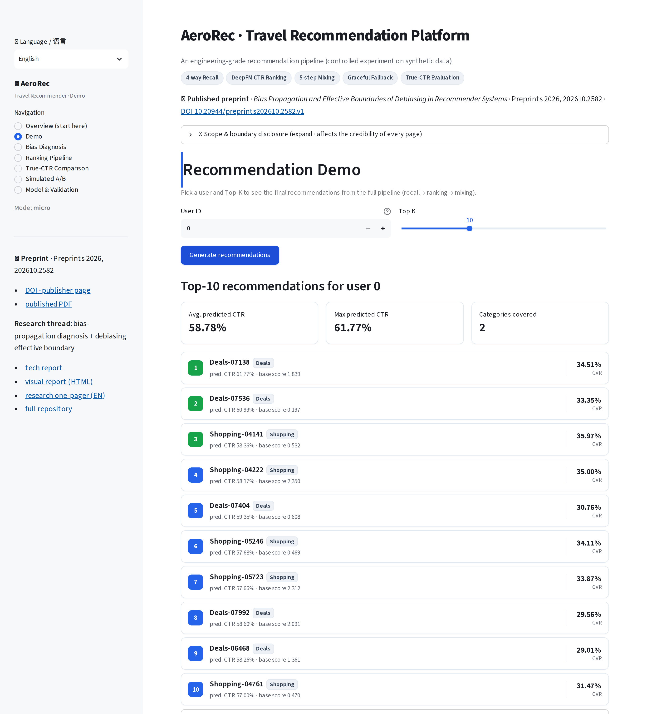
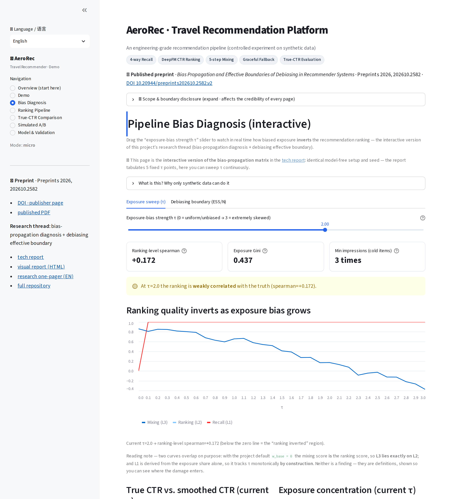
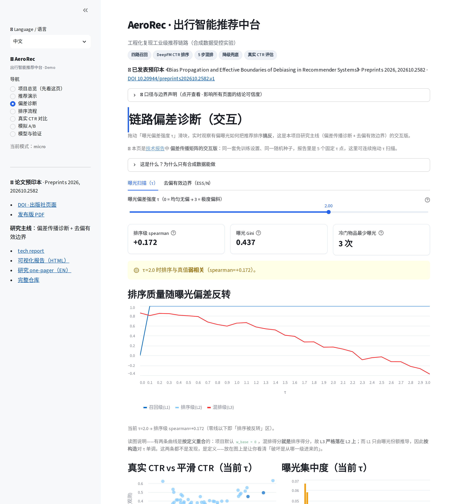

# AeroRec · 出行智能推荐中台

**一套端到端的推荐系统实现——四路召回、DeepFM 排序、五步混排、服务化 API 与双语面板——上面挂着一条研究主线：让曝光偏差变得「可测量」，而不是靠猜。**

> 🌐 [English](README.md) | 简体中文

[](https://github.com/Elijah-Lin-Dancer/AeroRec/actions/workflows/repro.yml)
[](https://www.python.org/)
[](LICENSE)
[](https://aerorec-tourism.streamlit.app)
[](https://elijah-lin-dancer.github.io/AeroRec/)
[](https://doi.org/10.20944/preprints202610.2582.v2)
[](https://doi.org/10.5281/zenodo.24003810)

AeroRec 在一份**可复现的合成数据**上复现工业推荐链路：四路召回 → 加权融合 → DeepFM / LR 多目标排序 → 五步混排 → FastAPI 服务 + 中英双语七页面板。数据生成器是解析式的，因此潜在 CTR 与记录策略的 propensity 都有**闭式真值**——偏差可以精确测量而非估计，本页每个结论背后都有一个数字。

**[在线 Demo](https://aerorec-tourism.streamlit.app)** · **[项目主页](https://elijah-lin-dancer.github.io/AeroRec/)** · **[论文预印本](https://doi.org/10.20944/preprints202610.2582.v2)** · **[技术报告](docs/bias_report.md)**

---

## 🎯 为什么看这个项目

1. **跑通的是整条链路，不是一个模型。** 热门 / ItemCF / Two-Tower / 规则四路召回 → 位置分加权融合 → DeepFM 出 CTR、LR 出 CVR → 归一化 / 加权 / 分层 / 打散 / 去重截断 → REST API 与七页面板。`133` 项测试，`ruff` + `mypy` 全绿。
2. **偏差对着已知真值来量。** 有闭式真值，排序损伤就藏不住：随曝光偏斜加剧，Spearman **+0.8665 → −0.5054**，榜单已经反转，而「平均 CTR 看着正常」。去偏存在可测边界 **ESS/N ≈ 0.358**，且这个量不需要真值就能算。
3. **数字逐字节可复现。** 7 组偏差实验在**仅 numpy** 下 **19 秒**跑完；产物在 CI 中重新生成并逐字节比对（`git diff --exit-code`）；论文里 **207** 个数字全部对产物审计，**0 差异**。
4. **能塞进 690 MB 内存。** 训练与推理解耦：离线用 torch，在线用纯 numpy 前向（最大偏差 **1.19e-07**），**服务期不加载 torch**——这一条由 CI 断言。在线：P50 **0.71 ms** / P99 **0.93 ms**，**1379 QPS**，**129 MB** 常驻内存。

## 📸 界面预览

<p align="center">
  
</p>
<p align="center">
  
  
  
  
</p>

> 应用默认打开**项目总览**页——一屏讲清「做了什么、四个关键数字、怎么引用」。其余依次是实时推荐、偏差扫描与模型页；最后一张是同一个偏差页的中文界面。全站**中英文一键切换**（侧边栏顶部，默认英文）。

## ⚡ 快速开始

```bash
# 30 秒看效果 —— 只需 numpy + streamlit，不装 torch，约 0.3 GB
pip install -r requirements.txt
streamlit run app.py

# 完整复现 —— 追加 torch / scikit-learn / pandas
pip install -r requirements_full.txt
python -m src.eval.evaluate              # LR vs DeepFM 的 AUC + 真实 CTR 口径 + oracle 上界
python scripts/run_bias_experiments.py   # 7 组偏差实验 -> data/bias/*.json（约 19 秒，仅 numpy）
python -m pytest -q                      # 133 项测试
```

| 命令 | 作用 | 依赖 |
|---|---|---|
| `python -m src.pipeline_demo` | 造数 → 四路召回 → 融合 → 出推荐 | 完整依赖，约 500 万行曝光 |
| `python -m src.eval.evaluate` | AUC 对比 + 真实 CTR 排序 + oracle 上界 | 完整依赖 |
| `python -m src.build_online_artifacts micro` | 离线训练并把 numpy 权重导出到 `artifacts/micro/` | torch |
| `uvicorn src.serve.app:app --port 8000` | REST 服务：`/health` `/recommend` `/explain` `/ab` | 完整依赖 |
| `python scripts/run_bias_experiments.py` | 传播 / 注入 / 边界 / 扫描 / 用户侧等实验 | 仅 numpy |
| `python scripts/build_bias_report.py` | 生成自包含 HTML 报告（内联 SVG、零 JS） | 仅 numpy |
| `python scripts/bench_inference.py --mode micro` | 延迟 / QPS / 内存基准 → `data/bench.json` | 仅 numpy |
| `python scripts/audit_paper_numbers.py --strict` | 复核论文全部 207 个数字 | 仅 numpy |
| `python scripts/make_paper_figures.py` | 由产物重画 6 张论文配图 | matplotlib |
| `python scripts/validate_real_data_deepfm.py --dataset adult` | 真实数据迁移性检查（亦可 `--dataset criteo`） | 完整依赖 |

**三档数据规模**，通过 `AEROREC_MODE=micro|lite|full` 切换（默认 `micro`）：

| 档位 | 规模 | 峰值内存 | 用途 |
|---|---|---|---|
| `full` | 10 万用户 × 10 万物品 × 500 万曝光 | 约 1.5 GB | 论文级、可引用结果 |
| `lite` | 2 万 × 2 万 × 100 万 | 约 0.93 GB | 2 GB 实例，可在线训练 |
| `micro` | 1 万 × 1 万 × 50 万 | **约 0.30 GB** | 免费实例（690 MB 下限），离线训练 + numpy 推理 |

三档共用同一套算法代码，只改数据规模与特征存储实现。

## 🗂️ 目录结构

<details>
<summary>展开目录树</summary>

```text
src/
  config.py / config_lite.py / config_micro.py   三档配置（仅规模不同）
  config_scale.py            通过 AEROREC_MODE 解析档位
  pipeline_demo.py           造数 -> 召回 -> 融合 -> 推荐
  build_online_artifacts.py  离线训练 + numpy 权重导出
  data/                      合成数据生成器（pandas / 纯 numpy）、Criteo、Adult
  feature/                   特征存储（pandas）+ numpy 存储（lite / micro）
  recall/                    热门 / ItemCF 基线、two_tower、规则、融合
  rank/                      deepfm、trainer、numpy_deepfm、numpy_lr、mixer、degrade
  eval/                      metrics、evaluate（AUC + 真实 CTR + oracle）、ab
  serve/                     engine（含 lite / micro）、FastAPI 应用、i18n 文案表
  bias/                      policy、injectors、metrics、propagation、estimators、
                             boundary（ESS 预警）、report（自包含 HTML）
app.py                       Streamlit 演示（七页、双语、默认 micro）
scripts/                     偏差实验、报告、基准、论文配图、数字审计、真实数据验证
tests/                       133 项测试，覆盖 data / rank / api / bias / 真实数据
docs/                        bias_report.md、tech-report.md、paper/、index.html（主页）
data/bias/                   7 份实验产物 + report.html
data/real_validation/        Criteo（100 万 / 20 万）与 Adult 验证结果
artifacts/micro/             预训练 numpy 权重（约 29 KB）
requirements.txt             仅部署所需：numpy + streamlit（Streamlit Cloud 读这份）
requirements_full.txt        torch / sklearn / pandas / fastapi / pytest / matplotlib
```

</details>

## 🧱 技术栈

| 层 | 实现 |
|---|---|
| 数据 | 带解析真值的合成生成器（`full` 用 pandas，`lite` / `micro` 用纯 numpy）；Criteo 与 UCI Adult 加载器用于迁移性检查 |
| 召回 | 热门、ItemCF、带负采样的 PyTorch Two-Tower、出行业务规则、加权融合 |
| 排序 | DeepFM（torch）出 CTR，逻辑回归出 CVR；导出为 numpy 供在线推理 |
| 服务 | FastAPI、Streamlit、纯 numpy 前向（运行期不依赖 torch / sklearn / pandas） |
| 研究 | IPS / SNIPS / DR 估计量、bootstrap 置信区间（B = 10000）、ESS 边界、闭式 propensity |
| 质量 | pytest（133 项）、ruff、mypy、GitHub Actions（产物逐字节零漂移门禁 + 论文数字审计） |

## ❓ 常见问题

<details>
<summary><strong>为什么要用合成数据，而不是公开数据集？</strong></summary>

本项目有两条结论——oracle 上界与无偏真实 CTR 口径——要求已知每个 *(用户, 物品)* 的潜在 CTR。真实日志只给点击（0/1），永远给不出 CTR 本身，所以这两件事在真实数据上原则上做不到。此外公开的出行数据集并不存在（涉及隐私与商业保密），而固定种子让整条链路可以一条命令复现。代价是明说的：合成数据覆盖不了真实噪声、长尾与概念漂移，因此这里的指标衡量的是**受控条件下的方法有效性**，不是线上可迁移性。

</details>

<details>
<summary><strong>在线路径为什么不用 torch？</strong></summary>

Streamlit 免费实例有 **690 MB 内存下限**。实测框架基线：`torch + sklearn + numpy + streamlit` = **673 MB**，只剩 16.7 MB 给数据，必然 OOM；`numpy + streamlit` = **73 MB**。于是训练留在离线，权重导出为 `.npz`（约 29 KB），在线只重跑 numpy 前向。逐样本校验最大偏差 **1.19e-07**，CI 断言 `torch_loaded = false`。

</details>

<details>
<summary><strong>ESS/N ≈ 0.358 是普适阈值吗？</strong></summary>

不是。它是在本项目的合成规模与先验下、用闭式 propensity 测出来的。真实系统得先估计 propensity，这会引入本实验不包含的误差——实际边界会**更严**。能迁移的是方法（信任何去偏估计之前先看 ESS/N），不是这个数字。

</details>

<details>
<summary><strong>混排的基础分权重为什么默认 0？</strong></summary>

因为候选池已经来自热门与规则召回，混排阶段再注入热门等于把偏差重新引回来。真实 CTR 口径实测：`w_base = 0.4` → +6.3%，`0.2` → +17.2%，**`0.0` → +20.1%**。效应的正负取决于注入了什么：与现有信号独立的信息有益，重复的热门信息有害。

</details>

<details>
<summary><strong>怎么复现本页的数字？</strong></summary>

```bash
pip install -r requirements_full.txt
python -m src.eval.evaluate              # AUC 0.8019、真实 CTR 0.6323、oracle 0.7153
python scripts/run_bias_experiments.py   # ESS/N 边界 0.358、Spearman -0.5054
python scripts/audit_paper_numbers.py --strict   # 207 项检查，0 差异
```

偏差这条线只需要 numpy，约 19 秒跑完。AUC 的可复现依赖一个细节：DeepFM 的权重初始化必须排在 `torch.manual_seed(SEED)` **之后**，否则 AUC 会跨环境漂移约 0.004。

</details>

<details>
<summary><strong>预印本 v1 到 v2 改了什么？</strong></summary>

数值只有一处：小规模去偏边界原报 `ESS/N = 0.3576`，该值无法由已发布代码复现；同配置重跑已提交的流水线得到 `0.3625`（正文与图注各出现一次）。另补了一句规模说明与作者贡献声明。结论——边界对流水线规模稳健——不变。v1 保留独立 DOI 继续在线，是该值的原始记录，对应仓库状态打了 `preprint-v1` 标签。

</details>

<details>
<summary><strong>Demo 需要 GPU 或付费实例吗？</strong></summary>

不需要。免费档就是设计目标：带浏览器驱动实测峰值约 297 MB，冷启动约 1 秒，请求时不训练。本地推理基准为 P50 0.71 ms / P99 0.93 ms、129 MB 常驻内存；免费实例会慢一些，但同一量级。

</details>

<details>
<summary><strong>这个项目<em>不</em>声称什么？</strong></summary>

不提出新算法——贡献是忠实地复现整条工程链路，加一套诚实的评估口径。不使用真实或公司数据：合成数据在本仓库生成，实习只提供了业务规则的灵感。合成指标未证明可迁移到真实出行流量，尽管同一套实现在 Criteo（AUC 0.7733）与 UCI Adult（0.9183）上通过了验证。在 Criteo 上深度交互**没有**明显优势（0.7733 对 LR 的 0.7716）。A/B 是离线反事实回放。完整清单见 [docs/bias_report.md](docs/bias_report.md) 与 [docs/tech-report.md](docs/tech-report.md)。

</details>

## 📝 更新日志

| 版本 | 日期 | 要点 |
|---|---|---|
| `v1.1.0` | 2026-11-06 | 首个 GitHub Release；归档至 Zenodo（概念 DOI + 版本 DOI）；已发布标签由仓库规则集锁定为不可变 |
| `v1.0.0` | 2026-11-05 | 论文数字全量审计与溯源文档；预印本 v1 线（2026-10-27 发布） |
| `v0.2.0` | 2026-10-15 | 7 组偏差实验的锚点——论文各表均可由该标签复现 |

含逐周里程碑的完整历史见 [CHANGELOG.md](CHANGELOG.md)。

## 📄 研究成果

<details>
<summary>预印本、DOI 与引用格式</summary>

> **Bias Propagation and Effective Boundaries of Debiasing in Recommender Systems: An Oracle-Based Diagnosis Study** — Yulin Zhao，*Preprints* 2026, 202610.2582（v2 发布于 2026-11-06；v1 发布于 2026-10-27）。14 页、6 图 8 表，CC BY 4.0。

- 预印本 v2：[10.20944/preprints202610.2582.v2](https://doi.org/10.20944/preprints202610.2582.v2) · [稿件页](https://www.preprints.org/manuscript/202610.2582/v2) · [PDF](docs/paper/AeroRec-preprints.org-v2.pdf)
- 预印本 v1：[10.20944/preprints202610.2582.v1](https://doi.org/10.20944/preprints202610.2582.v1) · [PDF](docs/paper/AeroRec-preprints.org-v1.pdf)
- 软件归档：Zenodo [概念 DOI](https://doi.org/10.5281/zenodo.24003810)（始终指向最新）· [版本 DOI](https://doi.org/10.5281/zenodo.24003811)（`v1.1.0`，`preprint-v2` 的逐字节快照）
- 论文各表各图到产物的逐条溯源：[docs/paper/PROVENANCE.md](docs/paper/PROVENANCE.md)

```bibtex
@article{zhao2026aerorec,
  title   = {Bias Propagation and Effective Boundaries of Debiasing in Recommender Systems: An Oracle-Based Diagnosis Study},
  author  = {Zhao, Yulin},
  journal = {Preprints},
  year    = {2026},
  number  = {202610.2582},
  doi     = {10.20944/preprints202610.2582.v2}
}

@software{zhao2026aerorec_zenodo,
  title   = {AeroRec: an oracle-based diagnosis platform for bias propagation and debiasing boundaries in recommender systems},
  author  = {Zhao, Yulin},
  year    = {2026},
  version = {1.1.0},
  doi     = {10.5281/zenodo.24003811},
  license = {MIT}
}
```

</details>

## 数据与许可

| 数据 | 是否入库 | 条款 |
|---|---|---|
| 合成数据（`data/processed*`、`data/raw*`） | 否——一条命令重新生成 | 本仓库生成，随仓库以 MIT 发布 |
| UCI Adult（`data/adult/`） | 否——按需加载 | 仅限研究用途；引用 Kohavi & Becker (1996) |
| Criteo 100 万样本（`data/criteo/`） | 否——需自行获取 | CC-BY-NC-SA 4.0（非商业） |
| 验证结果（`data/real_validation/*.json`） | 是 | 仅聚合指标，MIT |

真实原始数据一律不入库，只提交验证结果 JSON 作为证据。

## 许可

MIT — 见 [LICENSE](LICENSE)。
