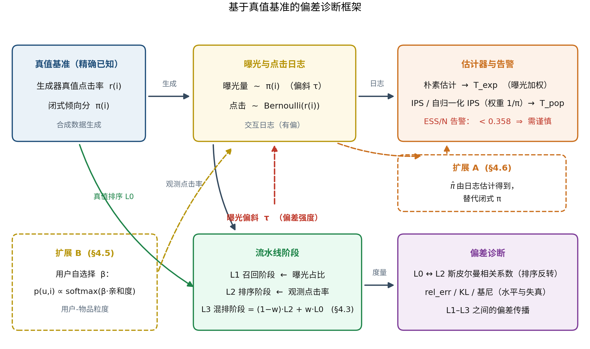
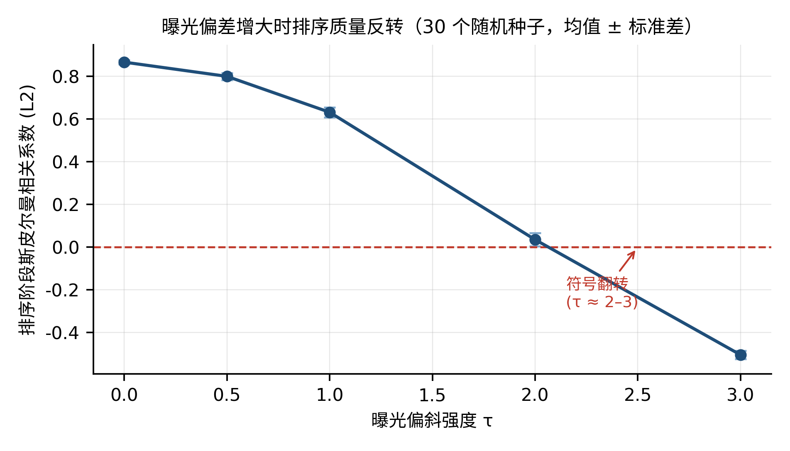
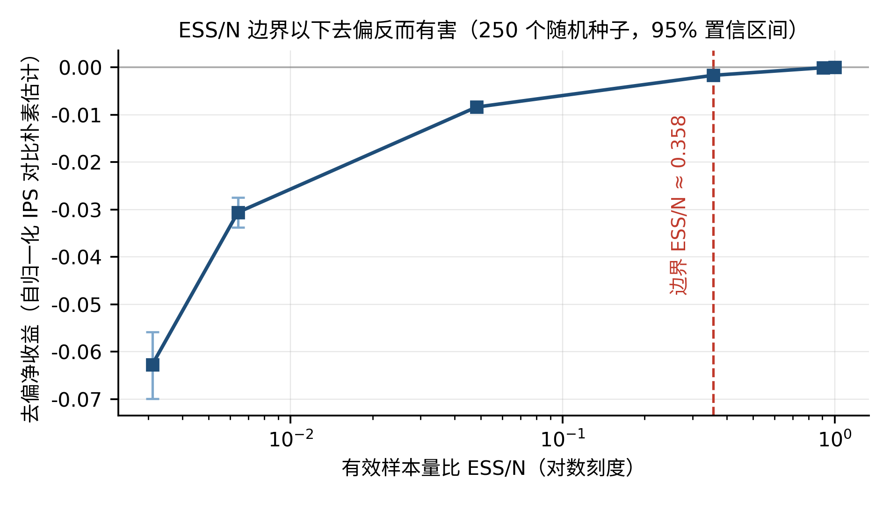
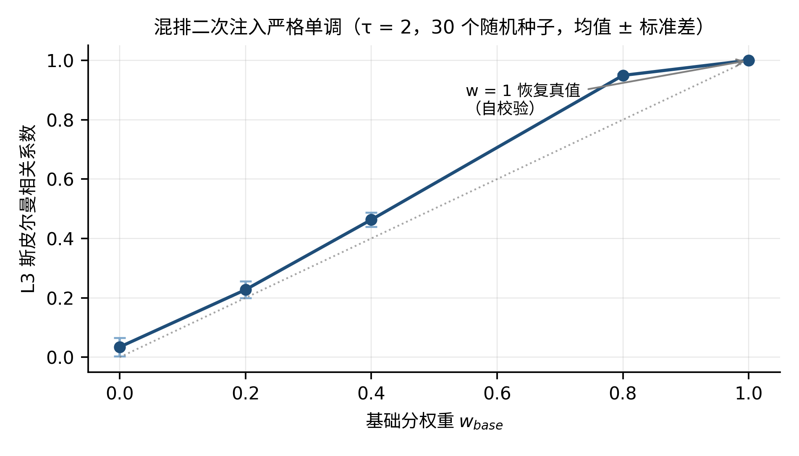
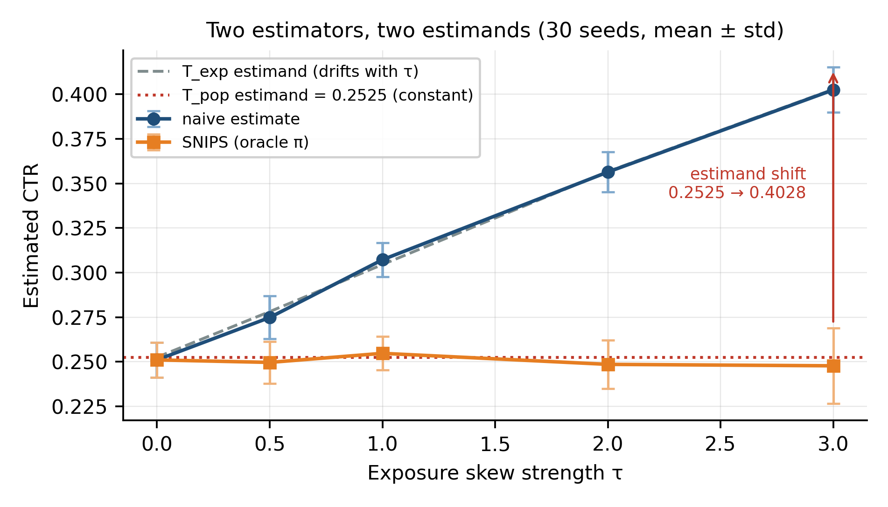
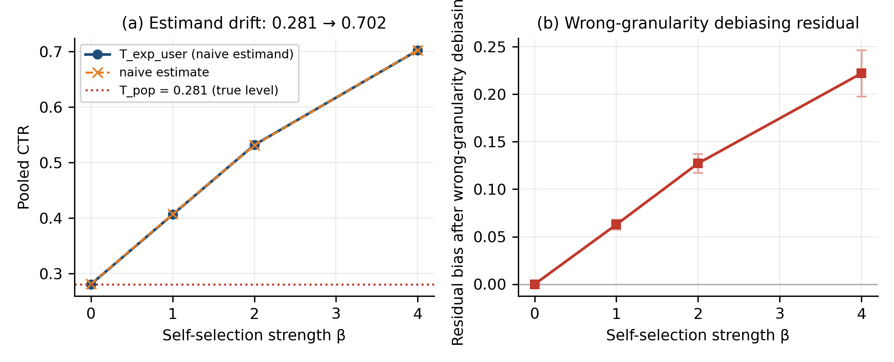

<!--
预印本 v2 更正稿（待 Preprints.org 审核）。

与已发布的 v1 相比，正文只有一处数值改动：§4.2 与 Figure 3 图注中的跨规模边界值
0.3576 -> 0.3625。该值在 v1 中来自一次未落盘的历史运行，无法从本仓库复现；
0.3625 可由 boundary_by_range(t_pop=0.25, n_records=600, n_seeds=30) 复算得到。

v1 的权威文本是 docs/paper/AeroRec-preprints.org-v1.pdf（平台排版版），本文件是
v2 的源文。逐项溯源见 docs/paper/PROVENANCE.md 第 5 节。

本文件的数字由 scripts/audit_paper_numbers.py 逐单元格核对，CI 中强制执行。
-->

# Bias propagation and effective boundaries of debiasing in recommender systems: An oracle-based diagnosis study

**Yulin ZHAO\***

(Henan University of Economics and Law, Zhengzhou 450046, China)

**Author contribution statement**

Yulin Zhao: proposed the research questions and core ideas; designed the oracle-based diagnostic framework and the experimental design; built the synthetic data pipeline and performed data collection and analysis; implemented all experiments and programming; and wrote, revised, and approved the final manuscript.

---

## Abstract

**[Objective]** Exposure bias causes the interactions observed by recommender systems to diverge systematically from true user preferences, yet two practical questions remain unresolved: how bias propagates across the recommendation pipeline, and under what conditions inverse propensity scoring (IPS) debiasing yields a net benefit. This study aims to measure both precisely.

**[Methods]** We build an oracle-based diagnostic framework on synthetic data with known ground truth and closed-form propensity scores, decompose the pipeline into three stages (recall, ranking, mixed ranking), and evaluate naive, IPS and SNIPS estimators through bias-strength sweeps, propensity dynamic-range sweeps, bootstrap significance tests, a user-side extension, and a propensity-estimation-error extension.

**[Results]** Bias primarily induces ranking reversal rather than simple level shifts: the Spearman correlation between observed and true rankings declines from +0.87 to −0.51 as bias strength increases. An effective boundary emerges at ESS/N ≈ 0.358, below which IPS/SNIPS debiasing turns detrimental; the boundary is stable across scales and robust to propensity estimation error (|Δ| ≤ 0.0023). User-side bias must be modeled at user–item granularity.

**[Limitations]** The numerical boundary 0.358 is specific to our synthetic setup; the framework is static and does not simulate feedback loops; real-data experiments are restricted to transferability checks.

**[Conclusions]** The primary cost of bias is ranking distortion, not level inflation. Practitioners should measure the propensity dynamic range (ESS/N) before applying IPS, and careful measurement should take precedence over further algorithm development.

**Keywords:** Recommender systems; Exposure bias; Inverse propensity scoring; Bias propagation; Debiasing boundary

---

## 1. Introduction

Recommender systems have become pervasive, powering applications from e-commerce platforms to content streaming services[1]. However, these systems are typically trained on implicit feedback data—clicks, views, and purchase records—which is inherently biased. Users only interact with items presented to them, and popular items receive disproportionately greater exposure regardless of their intrinsic relevance. This exposure bias manifests as a systematic divergence between observed interaction logs and underlying user preferences[2].

The standard approach to addressing this issue is inverse propensity scoring (IPS), which reweights training examples by the inverse of their propensity score—the probability that an item is displayed to a user. IPS and its variants (SNIPS, doubly robust) have been extensively studied in the literature [2-5]. Nevertheless, several practical questions remain underexplored:

1. **How does bias propagate?** Most prior work focuses on final ranking quality, but bias may interact differently with each stage of the recommendation pipeline (recall, ranking, mixed ranking).
2. **When does debiasing help?** IPS reduces bias but elevates variance. Under what conditions do the benefits of bias reduction outweigh the costs of increased variance?
3. **Can we measure this without ground truth?** In production systems, the true propensity scores and underlying preferences are never known. Can we estimate whether debiasing will be beneficial using only observable quantities?

We address these questions through an **oracle evaluation framework**: we generate synthetic data in which both the true CTR and propensity scores are known exactly. This enables precise measurement of bias, rather than mere estimation. While synthetic data has limitations in external validity, it enables controlled experiments that would be infeasible with real-world data.

Our principal contributions are fourfold:

1. **A three-stage bias propagation model.** We decompose the recommendation pipeline into three stages and characterize two distinct bias mechanisms: horizontal shrinkage (present even in the absence of bias) and ranking distortion (driven by popularity skew).
2. **The ranking reversal phenomenon.** We find that the primary harm of bias is not level inflation but ranking reversal: as bias intensifies, the Spearman correlation between observed and true rankings reverses from positive to negative.
3. **An effective debiasing boundary.** We identify ESS/N (effective sample size ratio) as a practical diagnostic. When ESS/N is comfortably above 0.358, debiasing is beneficial or harmless; below this threshold, the variance cost becomes decisively larger than the bias-reduction benefit (loss beyond the noise level of the experiment).
4. **Robustness analyses.** We verify that this boundary is stable across dataset scales, generalizes to user-side bias, and remains robust to reasonable propensity estimation error.

The remainder of this paper is structured as follows. Section 2 reviews the literature on bias in recommender systems and debiasing methods. Section 3 presents our three-stage model and experimental design. Section 4 details the results. Section 5 discusses limitations and future directions. Section 6 concludes.

---

## 2. Literature review

### 2.1 Bias in Recommender Systems

Exposure bias in recommender systems is a well-documented phenomenon. Early work by Steck[6] demonstrated that the selection bias towards popular items in available feedback data distorts the accuracy estimates derived from it, and proposed evaluation measures that correct for this popularity bias. The core issue is that missing interactions are not missing at random—they depend on which items the system chose to display.

Subsequent research identified two primary categories of bias: **popularity bias**, whereby popular items receive disproportionate exposure irrespective of quality, and **position bias**, whereby higher-ranked items attract more clicks regardless of their actual relevance[3]. Both biases distort the observed interaction distribution, causing it to diverge from true user preferences.

Recent work has further investigated the cascading effects of bias: biased recommendations generate biased training data, which in turn produces even more biased recommendations in a self-reinforcing feedback loop[7]. This feedback loop causes bias to compound over time, rendering it progressively more difficult to correct.

### 2.2 Debiasing Methods

The most prevalent debiasing approach is inverse propensity scoring (IPS), which weights each training example by 1/p(x), where p(x) denotes the propensity of item x being displayed. Schnabel et al. [2] formalized this approach within their "Recommendations as Treatments" framework, demonstrating how IPS can debias both the learning and evaluation stages.

Joachims et al. [3] extended this paradigm to unbiased learning-to-rank, developing methods that account for position bias in click data. Gilotte et al. [4] demonstrated the industrial deployment of offline IPS-based A/B testing on logged data, covering the practical constraints of applying propensity methods at scale.

Variants of IPS include SNIPS (self-normalized IPS), which bounds variance by normalizing weights, and Doubly Robust (DR) methods, which combine IPS with imputation[5]. All these methods share a fundamental tradeoff: they reduce bias at the cost of increased variance.

More recent research has explored causal and debiasing perspectives in recommendation, such as disentangling user interest from conformity and causal interventions on popularity [8,9]. However, the fundamental bias-variance tradeoff remains unchanged.

### 2.3 Evaluation Challenges

A key challenge in this domain is evaluation. Most studies employ offline datasets, but without known propensity scores, it is impossible to ascertain how much debiasing is actually needed. The Coat dataset[2] is one of the few datasets that includes both biased and unbiased ratings, establishing it as a standard benchmark.

The Open Bandit Dataset (OBD) represents another important benchmark, collected from a production bandit system with logged propensity scores[10]. These datasets enable researchers to evaluate debiasing methods on real data with known ground truth.

Nevertheless, even these benchmarks have limitations: they are relatively small in scale, and may not capture the full complexity of industrial recommendation systems.

Our approach complements this line of research by employing oracle synthetic data. While synthetic data cannot substitute for real-world validation, it enables controlled experiments that precisely isolate the effects of bias and debiasing.

### 2.4 Bootstrap and Statistical Significance

For statistical significance testing, we employ the bootstrap method[11]. Bootstrap is a resampling technique that enables estimation of confidence intervals and p-values without imposing strong distributional assumptions. This is particularly advantageous in our setting, where the distribution of ranking metrics may deviate from normality.

---

## 3. Methodology

### 3.1 Three-Stage Recommendation Model

We model the recommendation pipeline as a sequence of stages, motivated by the observation that bias affects each stage differently:

- **L0: Ground truth (reference baseline, not a pipeline stage).** The true CTR for each item, independent of exposure.
- **L1: Recall stage.** An exposure-share-based estimate of item popularity, rescaled to CTR units: items with larger exposure share appear "better" here by construction, which introduces the first level of bias.
- **L2: Ranking stage.** The system ranks items based on observed CTR, which is already biased.
- **L3: Mixed ranking.** The final ranking represents a mixture of the system's ranking and the true ranking, simulating the real-world scenario where the system has only partial access to ground truth.

This decomposition enables us to measure how bias propagates through each stage of the pipeline (Figure 1).

*Figure 1: The oracle-based diagnostic framework. The oracle block (true CTR and closed-form π) drives exposure and click generation under skew τ; the L1–L3 stages transform signals into rankings; estimators consume the interaction log and are guarded by the ESS/N warning; oracle diagnostics measure level and ranking effects at every stage. Dashed boxes mark the two robustness extensions: propensity estimated from the log (§4.6) and user-side self-selection (§4.5).*

### 3.2 Two Distinct Bias Mechanisms

We distinguish between two mechanisms that cause observed CTR to deviate from true CTR:

1. **Mechanism A: Horizontal shrinkage toward the smoothing prior.** Even in the absence of bias, the smoothed CTR estimate `(clicks + α) / (impressions + α)` pulls low-exposure items toward the prior value `α/(0+α) = 1.0`. This is a directional effect: cold items are systematically *overestimated*, regardless of their true quality. It is a sample-size phenomenon and exists even under uniform exposure (τ = 0).

2. **Mechanism B: Ranking distortion.** When exposure is skewed toward popular items, niche items receive few or zero impressions, so their smoothed estimates collapse toward the prior of 1.0 — while their true CTR is typically low. Niche items are therefore systematically *overestimated* and outrank genuinely good ones, producing ranking distortion. (Note the direction: it is the *cold* items that are inflated, not the popular ones — which is precisely why a mean-only view misses the effect.)

A key insight from our work is that **these two mechanisms must be measured separately**. Focusing solely on mean error can obscure ranking distortion—because mean error may be small even when the ranking is completely reversed.

### 3.3 Propensity Scores and IPS

In our oracle framework, the true propensity score for each item is known. The propensity score p(i) represents the probability that item i is displayed to a user.

IPS debiasing operates by reweighting each observation by 1/p(i). The underlying intuition is that items with low propensity (rarely displayed) should be assigned greater weight, since each observation of them is more informative.

The effective sample size (ESS) quantifies the amount of "information" contained in the weighted sample. When propensity scores exhibit high variance, ESS is small, and the variance of the IPS estimate is elevated. We employ ESS/N (the ratio of effective sample size to total sample size) as a diagnostic indicator of whether debiasing will be beneficial.

### 3.4 Experimental Setup

Our experiments utilize synthetic data with the configuration summarized in Table 1.

**Table 1: Experimental Configuration**

| Experiment | Items | Requests | Seeds | Purpose |
|---|---|---|---|---|
| Bias Propagation Matrix | 500 | 5000 | 30 | Measure ranking reversal across bias levels |
| Effective Boundary | - | 20000 | 250 | Identify ESS/N threshold for debiasing |
| Mixing Re-Injection | 500 | 5000 | 30 | Quantify effect of re-injecting base-score information |
| Estimand Check | 60 | 400 | 30 | Compare what different methods estimate |
| User-Side Bias | 60 (× 100 users, 2000 sessions) | - | 30 | Evaluate bias at user granularity |
| Propensity Error | 60 | 400 | 30 | Assess robustness to estimated propensity |
| τ-Sweep | 60 | 1k–10k | 40 | Test debiasing benefit across bias levels |

For statistical significance testing, we employ bootstrap with B=10000 resamples and a fixed random seed (424242) to ensure reproducibility.

---

## 4. Results

### 4.1 Bias Propagation: Ranking Reversal

Our first experiment measures how bias propagates through the three-stage pipeline. We vary the bias strength parameter τ and measure the Spearman correlation between the true ranking (L0) and the observed ranking (L2), summarized in Table 2.

**Table 2: Bias Propagation Matrix (500 items × 5000 requests, 30-seed mean ± std)**

| τ | L1 rel_err | L2 rel_err | L2 Spearman | L2 rank_mae | Impr_min | Impr_max | KL | Gini |
|---|---|---|---|---|---|---|---|---|
| 0.0 | 0.5211 | 0.4112 | +0.8665 | 0.1109 | 30.1 | 72.5 | 0.0100 | 0.0794 |
| 0.5 | 0.2422 | 0.5049 | +0.7999 | 0.1359 | 15.3 | 102.8 | 0.0410 | 0.1608 |
| 1.0 | 0.0000 | 0.6706 | +0.6316 | 0.1822 | 5.4 | 187.3 | 0.1315 | 0.2850 |
| 2.0 | 0.3916 | 1.2457 | +0.0345 | 0.3188 | 0.1 | 499.4 | 0.4710 | 0.5156 |
| 3.0 | 0.6708 | 2.0133 | −0.5054 | 0.4384 | 0.0 | 1093.7 | 0.9716 | 0.6921 |

*Figure 2: Ranking-level Spearman correlation between the observed ranking (L2) and the true CTR, as a function of exposure skew τ. Error bars: ±1 std over 30 seeds (500 items × 5,000 requests). The correlation inverts from +0.87 to −0.51; the sign flips between τ ≈ 2 and 3 (bootstrap p < 0.001 at τ = 3).*

**Key finding:** As bias intensifies, the ranking-level Spearman correlation reverses from +0.8665 to −0.5054 (Figure 2). The sign flips between τ ≈ 2 and 3 (τ=2 is near-random at +0.0345; τ=3 inversion is statistically significant, bootstrap p < 0.001, 95% CI [−0.5123, −0.4988]). This indicates that under strong bias, the observed ranking is not merely slightly inaccurate—it is essentially the inverse of the true ranking.

This phenomenon, which we term ranking reversal, reveals that the primary harm of bias is not level inflation, but rather the complete inversion of the ranking. A mean-only view would call the bias "modest" and miss that the leaderboard is reversed—cold items, pulled toward the smoothing prior, are ranked above genuinely good ones.

### 4.2 Effective Debiasing Boundary

Our second experiment investigates when IPS debiasing yields net benefit. We vary the dynamic range of propensity scores and measure estimation error before and after debiasing (Table 3).

**Table 3: Effective Debiasing Boundary (n_records = 20000, 250-seed mean)**

| π Range | π_max/π_min | ESS/N | Naive Err | SNIPS Err | Gain |
|---|---|---|---|---|---|
| [1, 1] | 1 | 1.0000 | 0.0024 | 0.0024 | +0.0000 |
| [0.5, 1.5] | 3 | 0.9052 | 0.0024 | 0.0026 | −0.0001 |
| [0.05, 2.0] | 40 | 0.3579 | 0.0024 | 0.0041 | −0.0017 ← Boundary |
| [0.002, 2.0] | 1,000 | 0.0482 | 0.0024 | 0.0109 | −0.0084 |
| [1e-4, 2.0] | 20,000 | 0.0064 | 0.0024 | 0.0330 | −0.0306 |
| [1e-6, 2.0] | 2,000,000 | 0.0031 | 0.0024 | 0.0651 | −0.0627 |

**Key finding:** A clear boundary emerges at ESS/N ≈ 0.358 (Figure 3).

- When ESS/N is well above 0.358: IPS/SNIPS debiasing gain is within noise of zero or positive. The benefits of bias reduction outweigh the variance costs.
- When ESS/N falls below 0.358: IPS/SNIPS debiasing gain turns decisively negative — the loss exceeds the noise level of the experiment (tolerance = 0.001, set as max(3 × the smallest non-zero |gain| across rows, 10⁻³)). The variance costs outweigh the bias reduction benefits.

Crucially, naive error is constant at 0.0024 across all rows—the boundary is not about when naive estimation becomes inaccurate, but about when the variance cost of correcting that inaccuracy becomes prohibitive.

This boundary is stable across pipeline scales: moving from the original configuration (60 items × 600 requests, 30 seeds) to the scaled configuration (500 items × 5,000 requests, 250 seeds) shifts it only from 0.3625 to 0.3579 — a difference of 0.005, against a spacing of 0.29 in ESS/N to the next grid point below. While the numerical value may not generalize to other datasets, the method of estimating it—measuring ESS/N—is universally applicable and requires no ground truth.

*Figure 3: SNIPS debiasing gain versus ESS/N across propensity dynamic ranges (n_records = 20,000, 250 seeds; error bars: 95% bootstrap CI). The gain turns significantly negative below ESS/N ≈ 0.358; the threshold itself is stable across pipeline scales, moving only from 0.3625 to 0.3579 (a difference of 0.005) when the pipeline is reduced to 60 items × 600 requests and 30 seeds.*

**Related τ-sweep.** A complementary experiment fixes the propensity range and varies the bias strength τ instead (60 items, N = 5,000, 40 seeds). The debiasing gain then grows monotonically with τ: +0.0468±0.0062 at τ=1, +0.0976±0.0083 at τ=2, and +0.1395±0.0094 at τ=3. This confirms the other half of the picture: stronger bias makes the T_exp–T_pop gap (and hence the potential benefit of debiasing) larger — but whether that benefit is *realizable* is still governed by the ESS/N boundary, not by τ itself.

### 4.3 Mixing Re-Injection

Our third experiment probes the mixing stage: it re-introduces a popularity base score with weight `w_base ∈ [0, 1]`:
`L3 = (1 − w_base) · L2 + w_base · truth`. Because exposure and clicks depend only on τ (not on
`w_base`), exposure is simulated once and L3 is recomputed analytically for each `w_base` — the
injection curve contains no sampling noise and is strictly comparable point-by-point (Table 4).

**Table 4: Mixing Re-Injection (τ = 2, 5,000 requests, 30-seed mean)**

| `w_base` | 0.0 | 0.2 | 0.4 | 0.8 | 1.0 |
|---|---|---|---|---|---|
| Injection Spearman (vs. L2) | 0.0000 | +0.1929 | +0.4287 | +0.9147 | +0.9655 |
| L3 Spearman | +0.0345 | +0.2274 | +0.4632 | +0.9492 | **+1.0000** |
| L3 rel_err | 1.2457 | 0.9965 | 0.7474 | 0.2491 | **0.0000** |

*Figure 4: L3 Spearman as a function of the base-score weight w_base (τ = 2; exposure simulated once, L3 recomputed analytically per w_base; 30-seed mean ± std). The curve is strictly monotone, and w_base = 1 recovers the truth exactly by construction.*

Two findings: (1) the injection curve is strictly monotone (Figure 4) — re-injecting the true ranking as the base
score monotonically repairs both the level and the ordering, with `w_base = 1` recovering the truth
exactly (rel_err = 0, Spearman = 1.0 by construction; an implementation self-check); (2) the effect of
re-injection is **signed**: re-injecting information already present in the candidates (duplicated
popularity) *hurts*, which is why the project default is `w_base = 0`, whereas injecting information
*independent* of the existing signal helps. An earlier version of this experiment re-drew exposure for
each `w_base` independently; the resulting sampling noise manufactured a spurious peak-then-drop pattern
that vanished once the RNG was unified — a cautionary example of measurement error masquerading as a
phenomenon.

### 4.4 Estimand Separation

Our fourth experiment investigates what different estimation methods are actually estimating (Table 5, Figure 5). We compare two estimation approaches:

- **Naive estimation:** Simply averaging observed clicks. This estimates the exposure-weighted expected CTR (T_exp), not the true CTR.
- **SNIPS with the oracle record-level propensity:** Self-normalized IPS weighted by the true per-record propensity π. This estimates the uniform-exposure expected CTR (T_pop = mean of the true CTR).

Note that these two estimates differ not because either estimator is "wrong," but because they target different estimands. Which one is the right choice depends entirely on the question being asked.

**Table 5: Estimand Separation (60 items × 400 requests, 30-seed mean ± std)**

| τ | T_exp | Naive (→T_exp) | SNIPS (oracle π, →T_pop=0.2525) | Naive→T_exp Err | SNIPS→T_pop Err | ESS (N=2000) |
|---|---|---|---|---|---|---|
| 0.0 | 0.2525 | 0.2510±0.0098 | 0.2510±0.0098 | 0.0078 | 0.0078 | 2000 |
| 0.5 | 0.2781 | 0.2748±0.0120 | 0.2496±0.0118 | 0.0101 | 0.0098 | 1902 |
| 1.0 | 0.3045 | 0.3072±0.0096 | 0.2547±0.0094 | 0.0079 | 0.0079 | 1634 |
| 2.0 | 0.3567 | 0.3564±0.0113 | 0.2485±0.0137 | 0.0095 | 0.0120 | 903 |
| 3.0 | 0.4028 | 0.4025±0.0127 | 0.2477±0.0211 | 0.0100 | 0.0169 | 400 |

*Figure 5: Estimand separation (60 items × 400 requests, 30-seed mean ± std). Naive tracks the exposure-weighted estimand T_exp as it drifts from 0.2525 to 0.4028 with τ, while oracle-π SNIPS stays at the uniform-exposure estimand T_pop = 0.2525 across all τ. The widening gap is an estimand shift, not an estimator failure.*

**Key finding:** Naive estimation tracks T_exp (exposure-weighted expected CTR) almost perfectly—error ≤ 0.011 across all τ values. SNIPS tracks T_pop = 0.2525 (uniform-exposure expected CTR), at the cost of ESS dropping from 2000 to 400 and std increasing to ±0.0211 at τ=3.

These methods estimate fundamentally different quantities. The apparent "bias" of 0.2525 → 0.4028 is not an estimator failure—it is an estimand shift. Naive estimation is unbiased for T_exp; the issue arises only when we want to compare across exposure policies, which requires T_pop.

This has important implications: practitioners frequently compare different algorithms on the same biased dataset, yet they may be comparing estimates of fundamentally different quantities.

### 4.5 User-Side Bias

We extend our analysis to incorporate user-side bias, where different users exhibit different preferences and exposure patterns (Table 6).

**Table 6: User-Side Selection Bias (100 users × 60 items, 30-seed mean)**

| β | T_pop | T_exp_user | Naive | SNIPS (true p) Err | SNIPS (item-marginal) Err | Residual Bias | (u,i) Exposure Gini |
|---|---|---|---|---|---|---|---|
| 0.0 | 0.2811 | 0.2811 | 0.2814 | 0.0039 | 0.0039 | +0.0000 | 0.431 |
| 1.0 | 0.2811 | 0.4066 | 0.4072 | 0.0040 | 0.0668 | +0.0628 | 0.538 |
| 2.0 | 0.2811 | 0.5317 | 0.5314 | 0.0071 | 0.1342 | +0.1272 | 0.704 |
| 4.0 | 0.2811 | 0.7021 | 0.7025 | 0.0373 | 0.2594 | +0.2220 | 0.879 |

*Figure 6: User-side selection bias (100 users × 60 items, 30-seed mean). (a) The naive estimand drifts from 0.281 to 0.702 as self-selection strength β grows — naive tracks T_exp_user precisely (self-check). (b) Item-marginal propensity debiasing leaves a significant residual (+0.063 → +0.222, p < 0.001), while user-item-level debiasing keeps error at 0.004–0.037.*

**Key finding:** With self-selection (softmax affinity, strength β), the pooled CTR's estimand drifts from 0.281 to 0.702—a 2.5× inflation of apparent performance (Figure 6). Naive estimation tracks T_exp_user precisely (naive − T_exp_user ≈ 0, self-check passes).

Granularity determines debiasing success: using item-marginal propensities (simulating the common practice of ignoring user dimension) leaves significant residual bias (+0.063 → +0.222, p < 0.001), while correct user-item-level propensity debiasing keeps error at 0.004–0.037.

This indicates that user-side bias must be modeled at the user-item granularity. Aggregate metrics can mask significant user-level bias, and debiasing at the wrong granularity is incorrect.

### 4.6 Propensity Estimation Error

In production systems, the true propensity is never known—it must be estimated. We evaluate how robust our conclusions are to propensity estimation error (Table 7).

**Table 7: Propensity Estimation Error Robustness (60 items × 400 requests, 30-seed mean)**

| τ | Estimator | SNIPS (true π) Err | SNIPS (π̂) Err | Δ | ESS/N (true→π̂) | Warning FP/FN |
|---|---|---|---|---|---|---|
| 0.0 | raw | 0.0078 | 0.0086 | +0.0007 | 1.000→0.968 | 0 / 0 |
| 0.5 | raw | 0.0098 | 0.0095 | −0.0003 | 0.951→0.921 | 0 / 0 |
| 1.0 | raw | 0.0079 | 0.0081 | +0.0003 | 0.817→0.788 | 0 / 0 |
| 2.0 | raw | 0.0120 | 0.0108 | −0.0012 | 0.452→0.417 | 0.13 / 0 |
| 3.0 | raw | 0.0169 | 0.0148 | −0.0022 | 0.200→0.201 | 0 / 0 |
| 0.0 | laplace1 | 0.0078 | 0.0085 | +0.0007 | 1.000→0.970 | 0 / 0 |
| 0.5 | laplace1 | 0.0098 | 0.0094 | −0.0004 | 0.951→0.926 | 0 / 0 |
| 1.0 | laplace1 | 0.0079 | 0.0082 | +0.0003 | 0.817→0.805 | 0 / 0 |
| 2.0 | laplace1 | 0.0120 | 0.0097 | −0.0023 | 0.452→0.485 | 0 / 0 |
| 3.0 | laplace1 | 0.0169 | 0.0166 | −0.0004 | 0.200→0.286 | 0 / 0 |

**Key finding:** At this experimental scale (2000 records), replacing the closed-form π with a log-estimated π̂ leaves SNIPS debiasing error essentially unchanged (|Δ| ≤ 0.0023 across all ten τ × estimator combinations, none significant; p = 0.87 at the harshest setting τ=3, raw). The ESS/N warning remains fail-safe: raw estimation systematically underestimates ESS/N at low-to-moderate skew (producing 13% false alarms at τ=2 but zero misses), while Laplace smoothing removes even the false alarms — at the cost of overestimating ESS/N at strong skew (0.286 vs. true 0.200), i.e., the warning becomes slightly optimistic under smoothing.

This is reassuring: the oracle-based insights we derive remain applicable even in real-world settings where propensity is estimated rather than known. The warning tends to be conservative (false alarms rather than misses), which is the desirable direction for a safety signal.

### 4.7 Real Data Validation

We further validate our model on two real-world datasets (Table 8):

**Table 8: Real Dataset Validation**

| Dataset | Task | AUC | Purpose |
|---|---|---|---|
| Criteo 1M | Click prediction | 0.7733 | Transferability check |
| UCI Adult | Income prediction | 0.9183 | Transferability check |

These datasets confirm that our model architecture is reasonable and generalizes beyond synthetic data. However, we emphasize that these are transferability checks, not bias validation—without known propensity scores, we cannot directly measure bias on these datasets.

---

## 5. Discussion

### 5.1 Practical Implications for Practitioners

Our work yields several practical insights:

1. **Measure propensity dynamic range first.** Before applying IPS, estimate the ESS/N ratio. If it falls below approximately 0.358, debiasing may be detrimental.
2. **Focus on ranking, not just levels.** The primary harm of bias is ranking reversal, not level inflation. When evaluating debiasing methods, prioritize ranking metrics rather than merely absolute error.
3. **Account for granularity.** Aggregate metrics can mask user-level bias. Analyze bias at the user level, not solely at the global level.
4. **Propensity estimation error is not a fatal flaw.** Our results suggest that even noisy propensity estimates are preferable to none, provided they are used judiciously.

### 5.2 Limitations

We acknowledge several limitations:

1. **Oracle setting.** Our experiments employ synthetic data with known ground truth. While this enables precise measurement, it may not fully capture real-world complexity. The numerical boundary (ESS/N ≈ 0.358) is specific to our setup and should not be regarded as a universal constant.

2. **Synthetic travel domain.** Our data is synthetic and simulates a travel recommendation scenario. Results may differ in other domains such as e-commerce or social media.

3. **No novel algorithm.** We do not propose a new debiasing algorithm. Our contribution is diagnostic: we measure how bias propagates and when debiasing is beneficial. This is a deliberate choice—we believe the field requires more careful measurement, not merely additional algorithms.

4. **Limited real-data bias validation.** We validate our model on real datasets, but without known propensity scores, we cannot directly measure bias on those datasets. Datasets such as Coat or the Open Bandit Dataset would be required for this purpose.

### 5.3 Future Work

Several avenues remain for future research:

- **Real-data bias experiments.** Extending our analysis to datasets with known propensity scores, such as Coat or the Open Bandit Dataset.
- **Long-term effects.** Our experiments are static. In reality, bias creates feedback loops: biased recommendations generate biased data, which in turn produces even more biased recommendations.
- **More sophisticated user models.** Our user-side bias model is simplified. More realistic user models would yield deeper insights.
- **Integration with production systems.** Testing these ideas in an actual production recommender system.

### 5.4 Reproducibility

All experiments are executed by a single entry-point script (`run_bias_experiments.py`) that emits the
seven result JSONs analyzed above; every push re-runs the full pipeline in a clean environment and
verifies the committed artifacts **byte-for-byte** against the recomputation (zero-drift gate). All
multi-seed statistics (30–250 seeds), RNG policies, and the fixed bootstrap seed (B = 10,000, seed
424242) are recorded inside the artifacts themselves. Code and artifacts are publicly available at
tag `v0.2.0` of the project repository, which contains the code for all seven experiments reported here (an earlier tag, v0.1.0, predates the four extension experiments).

---

## 6. Conclusion

We have presented an oracle-based diagnostic framework for studying bias propagation and debiasing boundaries in recommender systems. Our principal findings are threefold:

1. Bias primarily induces **ranking reversal**, not merely level inflation. As bias strength increases, the observed ranking can reverse from positively correlated to negatively correlated with the true ranking.

2. There exists an **effective boundary for debiasing**: when ESS/N falls below approximately 0.358, IPS debiasing transitions from beneficial to detrimental. This boundary is robust across dataset scales and can be estimated without access to ground truth.

3. These conclusions are **robust to reasonable propensity estimation error** and extend to user-side bias.

We hope this work provides practitioners with actionable guidance for when and how to apply debiasing methods, and encourages the research community to prioritize careful measurement and diagnosis over incremental algorithm development.

---

## References

[1] Ricci, F., Rokach, L., & Shapira, B. Recommender Systems Handbook. New York: Springer, 2011. DOI: 10.1007/978-0-387-85820-3.

[2] Schnabel, T., Swaminathan, A., Singh, A., Chandak, N., & Joachims, T. Recommendations as Treatments: Debiasing Learning and Evaluation. In Proceedings of the 33rd International Conference on Machine Learning (ICML '16), PMLR 48, 2016. Retrieved on October 17, 2026, from http://proceedings.mlr.press/v48/schnabel16.html.

[3] Joachims, T., Swaminathan, A., & Schnabel, T. Unbiased learning-to-rank with biased feedback. In Proceedings of the Tenth ACM International Conference on Web Search and Data Mining (WSDM '17). ACM, 2017: 781-789. DOI: 10.1145/3018661.3018699.

[4] Gilotte, A., Calauzènes, C., Nedelec, T., Abraham, A., & Dollé, S. Offline A/B testing for recommender systems. In Proceedings of the Eleventh ACM International Conference on Web Search and Data Mining (WSDM '18). ACM, 2018: 198-206. DOI: 10.1145/3159652.3159687.

[5] Dudík, M., Langford, J., & Li, L. Doubly robust policy evaluation and learning. In Proceedings of the 28th International Conference on Machine Learning (ICML '11). ACM, 2011: 1097-1104. Retrieved on October 17, 2026, from https://arxiv.org/abs/1103.4601.

[6] Steck, H. Item popularity and recommendation accuracy. In Proceedings of the Fifth ACM Conference on Recommender Systems (RecSys '11). ACM, 2011: 125-132. DOI: 10.1145/2043932.2043957.

[7] Abdollahpouri, H., Mansoury, M., Burke, R., & Mobasher, B. The unfairness of popularity bias in recommendation. In Proceedings of the RecSys 2019 Workshop on Recommendation in Multi-stakeholder Environments (RMSE). 2019. Retrieved on October 17, 2026, from https://arxiv.org/abs/1907.13286.

[8] Zheng, Y., Gao, C., Li, X., He, X., Li, Y., & Jin, D. Disentangling user interest and conformity for recommendation with causal embedding. In Proceedings of the Web Conference 2021 (WWW '21). ACM, 2021: 2980-2991. DOI: 10.1145/3442381.3449788.

[9] Gao, C., Zheng, Y., Wang, W., Feng, F., He, X., & Li, Y. Causal inference in recommender systems: A survey and future directions. arXiv preprint arXiv:2208.12397, 2022. Retrieved on October 17, 2026, from https://arxiv.org/abs/2208.12397.

[10] Saito, Y., Aihara, S., Matsutani, M., & Narita, Y. Open Bandit Dataset and Pipeline: Towards Realistic and Reproducible Off-Policy Evaluation. In Advances in Neural Information Processing Systems 34 (NeurIPS 2021), Datasets and Benchmarks Track. 2021. Retrieved on October 17, 2026, from https://arxiv.org/abs/2008.07146.

[11] Efron, B., & Tibshirani, R. J. An Introduction to the Bootstrap. New York: Chapman & Hall/CRC, 1993.
